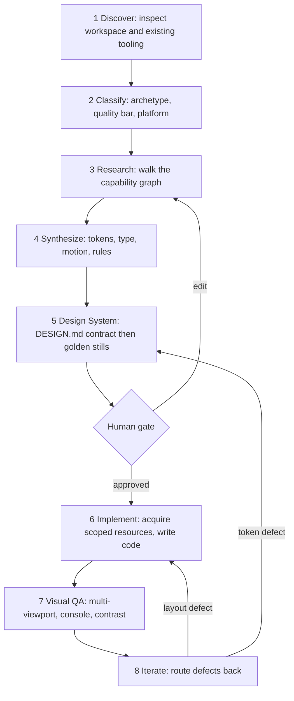

# Architecture — Orchestra 3.3.5

The contract pin is 3.3.5. The 3.3.2 mechanisms (mission, capsule, Layer A/B, capability select, the T1/T3 pilot) are specified in [`docs/3.3.2/ORCHESTRA_3_3_2_ARCHITECTURE.md`](docs/3.3.2/ORCHESTRA_3_3_2_ARCHITECTURE.md) and summarized in the README. They do not replace this OS. Stable `v3.3.2` waits for phase 3I.

Orchestra is a **control plane**. Your agent is the executor.

**ORCHESTRA = CONTROL PLANE. SKILLS / MCPs / PLUGINS / LIBRARIES = CAPABILITIES. AGENTS = EXECUTORS. BRAIN = MEMORY. REGISTRY = RESOURCE KNOWLEDGE.**

The **registry** is the resource catalog. The **graph** is capability routes (17 rows, each with trigger and skip). Host rules and IDE customizations are adapters. They never implement a competing orchestration policy.

## The eight stages



Backend, research, and documentation tasks run the same spine with stages 4–5 collapsed into a technical plan and stage 7 replaced by tests and static analysis.

## Mission execution (3C)

The eight stages stay the executor. Around them the engine now keeps a compact, provider-neutral control plane:

```
MISSION → CONTEXT SELECTION → WORKER CAPSULE → BUDGET → EXECUTION → EVIDENCE / RESULT → FAILURE CLASSIFICATION → RECOVERY OR HUMAN GATE
```

- **Mission** — run-scoped JSON (`runtime/internal/mission`). Objective, quality bar, LIGHT/FULL intensity, immutable acceptance, derived execution budget. Not a Brain dump.
- **Worker capsule** — one assignment: role (planner/builder/judge), named files, skill ids, constraints, acceptance, prior failures. No conversation history, MCP catalog, or unrelated skills.
- **Budget** — derived per task (`reasoning`, `context`, `research`, `visual_review`, `independent_judge`, `retry_budget` 0–4). Ordinary API/debug stays cheap. **3D** consumes `visual_review` / `independent_judge`: harness Layer A/B when budgeted; independent judge only when policy triggers.
- **Failure class** — environment, dependency, provider/tool, implementation, test, specification, human-needed, timeout/resource. Non-zero exit is not automatically “implementation.”
- **Recovery** — retry only with remaining budget **and** a change (input/context/strategy/tool/approach/environment). Identical signatures stop. Specification and human-needed never auto-retry.
- **Durable state** — `.orchestra/runs/<id>/mission.json` + `state.json` (FULL also writes `progress.txt`). Enough to continue without replaying chat. Existing `.orchestra/handoff/state.json` is unchanged.

Quality bars remain STANDARD / PREMIUM / EXPERIMENTAL. Intensity is not a fourth bar.

## Five subsystems

1. **Registries** (`registries/`) — machine-readable resource catalog and the capability graph, validated by JSON Schema. JSON is canonical.
2. **Engine** (`runtime/internal/engine`) — the eight-stage state machine, plus the 3C mission/capsule/budget/failure bind (`runtime/internal/mission`).
3. **Acquisition adapters** (`runtime/internal/adapters/acquisition`) — npm, git, CLI, MCP, and web reference fetch. Scoped `GLOBAL` / `PROJECT` / `ON_DEMAND`. Global package installs are blocked.
4. **Host adapters** (`runtime/internal/adapters`) — keep Cursor, Antigravity, and Claude Code on one capability contract.
5. **Resource memory** — durable outcomes per resource. Only real executed jobs write rows.

## Gates

| Gate | Rule |
| --- | --- |
| Design Lab | `PREMIUM` / `EXPERIMENTAL` visual work blocks product frontend writes until `CONTRACT_APPROVED` and `ApproveStills`. Golden stills are pre-implementation evidence. `STANDARD` is exempt unless requested. |
| Real-app verification | Launch and exercise the application. Source inspection is not verification. |
| Correctness review | Bugs, missing behavior, security. |
| Simplify review | Duplication, needless abstraction, dead complexity. Separate pass. |
| Evidence-first | `DONE` / `VERIFIED` / `PASSED` require observed output in the same message. |
| Human-needed (3C) | Stop automatic execution on ambiguous product behavior, missing credentials, destructive actions, spec/contract conflict, uninterpretable acceptance, identity/brand, stills/direction pick, security-sensitive change, irreversible deploy, material tool/host gap, or repeated bounded failure. `ErrHumanGateRequired` is the existing sentinel. |

## Resource lifecycle

```
discovered → selected → acquired → used → verified
```

Presence in a registry is not usage. A resource counts as used only when it ran and the result was checked.

## Quality bars

- `STANDARD` — efficient product work. No slop, no lab overhead.
- `PREMIUM` — multi-source research, Design Lab, visual QA, iteration.
- `EXPERIMENTAL` — 3D, shaders, WebGL, novel interaction. Always with a low-end fallback.
