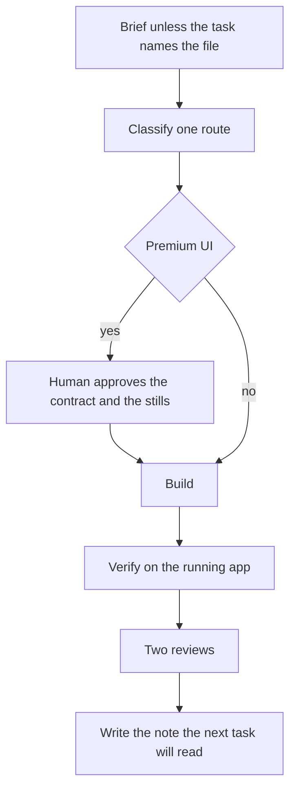
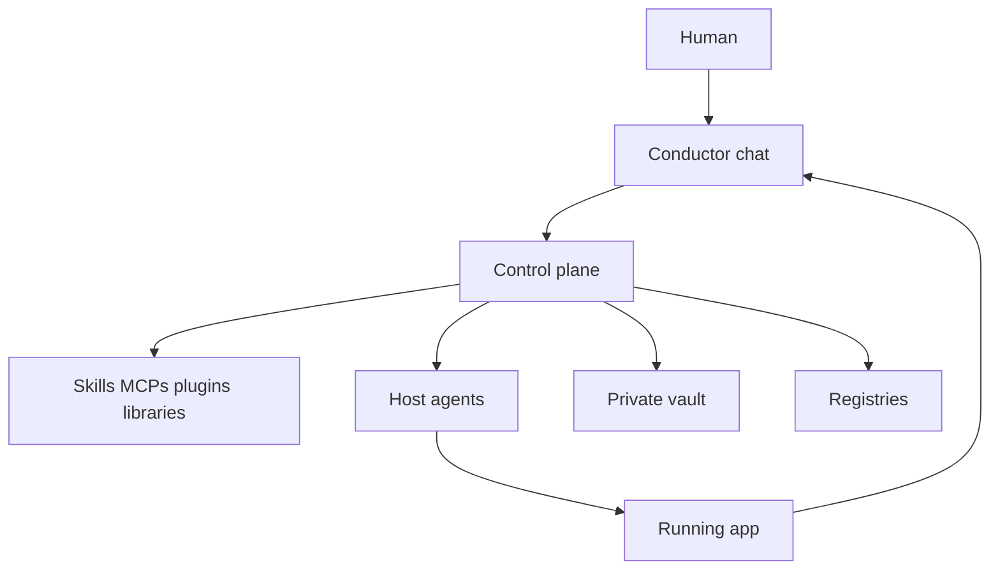
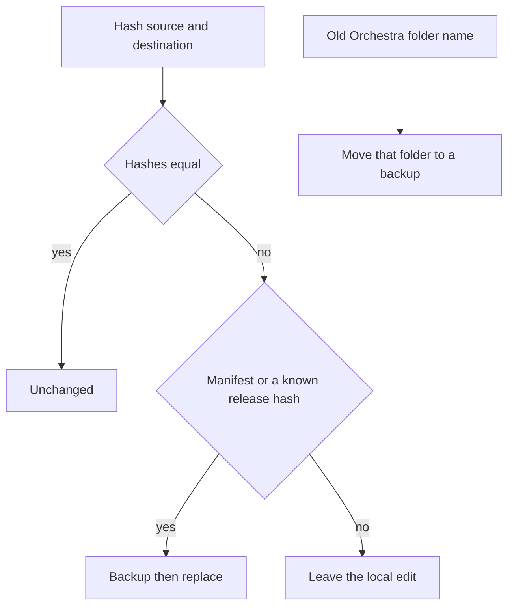

# Orchestra Workflow

Orchestra 5.5.0 is the control plane for Cursor, Claude Code, Antigravity, Codex, jcode, and the agents host. One chat conducts. Skills, MCPs, plugins, and libraries are capabilities. Agents execute. A private vault remembers. The registries say what exists. Host files are adapters.

The pin in [`VERSION`](VERSION) is **5.5.0**. Tag `v5.5.0` is commit `f13f17e`. Tags `v5.0.0` (`24ad53c`), `v4.7.0` (`62b58d8`), and `v4.6.0` (`6d05e43`) stay where they were.

```
ORCHESTRA  = CONTROL PLANE
SKILLS / MCPs / PLUGINS / LIBRARIES = CAPABILITIES
AGENTS     = EXECUTORS
BRAIN      = MEMORY
REGISTRY   = RESOURCE KNOWLEDGE
```

This repository is the method. Products, keys, and taste stay in a private workspace.

[CI](https://github.com/mahik504/orchestra-workflow/actions/workflows/ci.yml) run [43292132146](https://github.com/mahik504/orchestra-workflow/actions/runs/43292132146) and [Hygiene](https://github.com/mahik504/orchestra-workflow/actions/workflows/hygiene.yml) run [43292132536](https://github.com/mahik504/orchestra-workflow/actions/runs/43292132536) succeeded on `f13f17e`. A badge is a link. The run page is the result.

## What's new

5.5.0 stops a skipped check from reading as a pass.

A route with no keyword hit scores confidence 0. A unique hit stays at 1. On a split, confidence is the winner's score divided by the two top scores. `orchestra doctor` prints ABSENT when the quarantine directory is missing and does not invent a file count. Zero hosts, and a missing memory file, print NOT_RUN. A visual check that does not apply is `NOT_APPLICABLE`, and that result is not stored as a successful iteration. An empty `orchestra plan` exits 1.

Resource memory stores a sha256 of the task text, redacts secret-shaped notes, keeps the last 500 rows, and refuses a symlink. `orchestra memory scrub` rewrites an older row that still holds the raw task. Codex is on the default host map. The Antigravity desktop skills stay in `~/.gemini/config/skills`. The CLI path is opt-in. Browser regression loads `ow-qa`. `ow-browserize` and `ow-author` stay commands.

Thirty vendored rows that said `unspecified` now name a license read from the skill file or the upstream repository. No skill was added. Before these edits, `go test -count=1 ./...` from `runtime/` reported 776 passed in 26 packages. After the edits, the same command reported 795 passed. Route agreement reported 36 skills, 47 routed, 11 off the graph, and 0 problems. Heavy-route skill bytes, measured and not a cap: award-style site 56621, full-stack app 18698, mobile app 39661. `AGENTS.md` is 2047 characters. Skill descriptions total 25614.

The paired eval was not run. `compare.go` stays disabled. The claim stays none.

Older pins are in the version table below and in [`CHANGELOG.md`](CHANGELOG.md).

## Why this exists

The hosts already had skills, MCP servers, and plugins. Installing another pack on top of them opened a second plan in the same chat. A website prompt could load a mobile stack. A missing tool could be fetched mid-task. A command could print PASS for a check that never ran.

Orchestra is the layer that decides which of those capabilities load for one task, and which stay unloaded. Mahaveer Singh Gehlot built it as the method for his own hosts. The public repo is that method. The private vault is the memory.

## What it is for

One person describes a job. The conductor names the route, the skills, and the reason to leave other skills unloaded. Then the host agent builds, and the work is done only after a check that actually ran.

The route table is [`docs/ROUTING.md`](docs/ROUTING.md). A named skill wins unless it is unsafe. A missing tool stops. It does not install itself. `skip orchestra` stands the conductor down for that chat. Plain text, not a slash command.

The jobs the table already names: an award-style site, a site to echo, scroll, one 3D scene, a SaaS or API, a bug, a browser regression, a paper, a deck, an architecture diagram, one control, Next.js speed, a TypeScript review, shipping a deployed app, recent public research, marketing copy, a rendered video, career notes, a README, app recon, a hackathon, a spec, unslop, a codebase map, an isometric explainer, a full-stack app, an MCP server, an ML experiment, an essay, a mobile app, site recon, a scrape, UI assembly, waves, and an MCP audit.

## How a task moves

`ow-forge` writes a short brief when the job is open. A fix that already names the file skips the brief and the spec gate. The conductor classifies one row from the route table. `orchestra compile` prints the route, the skills, the model class, and the disclosure level. Premium UI still waits for a human yes on the contract and the stills. The agent builds. Verify runs on the running app. Two reviews follow. A like, a hate, or a decision is written the same turn into the private vault, and the next task reads the matching note.



`orchestra compile --task "..." --host cursor --json` is the command. Keyword length scores the route. A tie above zero is ambiguous. A miss has confidence 0.

A STANDARD fix that names the file goes straight to the build. Anything else that needs a spec goes through `egm-draft`, `egm-review`, and `egm-resolve`. The human still approves the spec. Goldfish review wants a fresh subagent. The reviewer prompts live inside each `egm-*` skill.

`taste-design` writes `DESIGN.md`. One builder runs in a pass. `impeccable` reviews a surface that already exists. `unslop` polishes a screen that already exists. An award-style site loads `build-awwwards-quality-sites`, `taste-design`, `impeccable`, `ow-golden-still`, and the three GSAP scroll skills. GSAP owns scroll. One 3D scene, and that scene is `ow-3d-engineering`.

Disclosure loads in order: the task and the acceptance line, the route row, the selected skill, its references, then tool output. Leave the rest unloaded.

The engine around that loop keeps a mission, a worker capsule, a budget, and a browser check. The eight stages are Discover, Classify, Research, Synthesize, Design system, Implement, Visual QA, and Iterate. They are drawn in [`ARCHITECTURE.md`](ARCHITECTURE.md). A backend, a paper, or a bug uses the same spine with the design stages collapsed and visual QA replaced by tests.

## Architecture



The graph in `registries/design-resource-graph.json` has 33 capabilities and 42 domains. Each has a trigger and a skip. Host rules are adapters. They do not carry a second orchestration policy. The model the host chooses does not pick the skill. The route does.

Resource telemetry is a JSON ledger of resource id, outcome, and a sha256 of the task text. It is not the vault. The vault holds taste, decisions, and one note per product. `LoadDurable` can read eight facts. The main pipeline does not call it.

Sync hashes the source tree and the destination. Equal hashes stay. A destination that matches a known release hash is backed up and replaced. A file you edited, whose hash matches none of those, stays. An old Orchestra folder name moves to a backup. A symlink inside a skill is refused.



## Version history

| Version | Commit | What changed | What was measured |
| --- | --- | --- | --- |
| 5.5.0 | `f13f17e`, tag `v5.5.0` | Miss confidence 0. NOT_RUN when a check did not run. Hashed memory and `orchestra memory scrub`. Codex on the default host map. Browser regression loads `ow-qa`. Thirty licenses named from the file or the upstream repo | Go suite 795 passed in 26 packages. Paired eval not run. Claim none |
| 5.0.0 | `24ad53c`, tag `v5.0.0` | Site recon, app recon, scrape, UI assembly, waves, and MCP audit are routes. `orchestra mcp-serve` is experimental | Eval fixtures stayed `not_run`. Claim none |
| 4.7.0 | `62b58d8`, tag `v4.7.0` | A handoff is `PREPARED` until a real build runs. `orchestra verify` exits non-zero on FAIL, BLOCKED, or NOT_RUN. The route table is `docs/ROUTING.md`. Hooks warn before strict mode | No study of success rate against a raw host |
| 4.6.0 | `6d05e43`, tag `v4.6.0` | Spec review is `egm-draft`, `egm-review`, `egm-resolve`. Upstream skills keep their names. Sync writes adapters when the file is already Orchestra. Plugin manifests at the repo root. Mermaid fences parsed in CI | Landing rerun recorded below. Claim none |
| 4.5.0 | `f4208a3`, tag `v4.5.0` | Orchestra-owned skills renamed to `ow-*`. Hash sync. `orchestra compile`. No skill-count cap | Three bugfix trials and three landing trials on `composer-2.5-fast`. Claim none |
| 4.2.0 | `60cf9e7`, no tag | `grilling`, `domain-modeling`, `to-tickets`, `constraint-driven-development`, `receiving-code-review`. Packs that would open a second plan stay off | Landing comparison not run |

4.0.0 put the routes in one table the hosts share. 4.1.0 made the receipt name what a task loaded. 1.0.0 through 3.3.6 are the earlier control plane, the design gate, and the host adapters. The long notes are in [`CHANGELOG.md`](CHANGELOG.md).

## Other harnesses

Stars below are `stargazers_count` from the GitHub API on 2026-11-13. A star count is popularity. It is not a task score, and it is not adoption of Orchestra. `karpathy/autoresearch` returned no SPDX license id.

| Repository | Stars | License | Pushed | What it is here |
| --- | ---: | --- | --- | --- |
| [mattpocock/skills](https://github.com/mattpocock/skills) | 322894 | MIT | 2026-11-12 | Four skills copied. The rest, and the setup command, stay out |
| [obra/superpowers](https://github.com/obra/superpowers) | 316701 | MIT | 2026-11-03 | Skills vendored. The plugin stays off |
| [affaan-m/ECC](https://github.com/affaan-m/ECC) | 301909 | MIT | 2026-11-09 | Not installed |
| [NousResearch/hermes-agent](https://github.com/NousResearch/hermes-agent) | 262932 | MIT | 2026-11-12 | Not installed. Its installer is a remote script |
| [github/spec-kit](https://github.com/github/spec-kit) | 149521 | MIT | 2026-11-12 | Acceptance line stays in `ow-forge`. The framework stays out |
| [garrytan/gstack](https://github.com/garrytan/gstack) | 141364 | MIT | 2026-11-12 | Not installed |
| [karpathy/autoresearch](https://github.com/karpathy/autoresearch) | 99937 | API returned none | 2026-03-26 | A training experiment. Not a coding harness |
| [OpenHands/OpenHands](https://github.com/OpenHands/OpenHands) | 93340 | MIT | 2026-11-12 | A coding agent. Not installed |
| [cline/cline](https://github.com/cline/cline) | 71563 | Apache-2.0 | 2026-11-12 | A coding agent. Not installed |
| [bmad-code-org/BMAD-METHOD](https://github.com/bmad-code-org/BMAD-METHOD) | 55304 | API returned no SPDX id | 2026-11-12 | Reviewer roles are two agent files. The method stays out |
| [Aider-AI/aider](https://github.com/Aider-AI/aider) | 50092 | Apache-2.0 | 2026-05-22 | A coding agent. Not installed |
| [EveryInc/compound-engineering-plugin](https://github.com/EveryInc/compound-engineering-plugin) | 26050 | MIT | 2026-11-12 | Read as a method source. Not installed |
| [SWE-agent/SWE-agent](https://github.com/SWE-agent/SWE-agent) | 20786 | MIT | 2026-11-09 | A coding agent. Not installed |
| [open-gsd/gsd-core](https://github.com/open-gsd/gsd-core) | 11486 | MIT | 2026-11-12 | Not installed. The active Get Shit Done repo. Progress here is the receipt |

The commits we opened are in [`docs/evaluations/harnesses.md`](docs/evaluations/harnesses.md). The 2026-11-12 reading, including cells that 5.5.0 later changed, is [`docs/audit/COMPETITOR-MATRIX-5.5.md`](docs/audit/COMPETITOR-MATRIX-5.5.md).

| | Orchestra 5.5.0 | Superpowers | ECC | gstack | GSD Core | Pocock skills | Karpathy |
| --- | --- | --- | --- | --- | --- | --- | --- |
| Role | The only conductor | A skill pack plus a session-start plugin | Host trees, hooks, and install scripts | Role commands for review and ship | A phase loop with its own executors | Procedure skills for engineering | `autoresearch` trains a small model. Gist `442a6bf555914893e9891c11519de94f` is a markdown wiki |
| What this repo took | The method | Vendored skills, plugin off | Nothing | Nothing | The idea of progress you can point at. Their conductor stays out | `grilling`, `domain-modeling`, `to-tickets`, `constraint-driven-development` | Short context and one next action. No skill named after a person |
| Second plan | `skip orchestra` stands this down | The plugin would open one | Installing the pack would | Their README tells the agent to rewrite `CLAUDE.md` | Their installer injects its own commands | Their setup command was left out | Not a conductor |
| Routing | [`docs/ROUTING.md`](docs/ROUTING.md). A miss scores 0 | Skills trigger from their own text, at the commit we opened | Not used as a scored table here | Slash commands | Named phases | Named skills | None |
| Check that did not run | NOT_RUN. `compare.go` disabled | Not in a paired trial on this pin | Not in a paired trial on this pin | Not in a paired trial on this pin | Their README states reliability. That sentence was not a trial against Orchestra | Not in a paired trial on this pin | Not a trial |
| Memory | Private vault, plus a hashed ledger of the last 500 resource rows | Not the memory this method runs | Their docs describe a vault. Not installed | A gbrain note exists. Not installed | `STATE.md` and `CONTEXT.md` in their README | Not opened for this table | Wiki schema. Not installed |
| Where their tree is ahead of this one | Hot-path `ow-*` skills now have a procedure. Many other `ow-*` files are still stubs | A required brainstorm, plan, TDD, and review loop, with skill bodies for that loop | Host trees and security guides we did not install | Browser review commands we did not run | A file-state loop and a clean context per executor, described in their README | A longer engineering list than the four skills copied here | A wiki the human and the model edit together. We did not build one |

Compound Engineering, Spec Kit, Agency Agents, CrewAI, and Ruflo were opened at the commits in the harness note and not installed. OpenHands, Aider, Cline, and SWE-agent are repository-level coding agents. They were not scored against Orchestra.

### Whether this works better

The promotion gate has not opened. `PromoteSkill` stays closed unless a saved trial clears it. 5.5.0 did not run that trial. The claim stays none.

The design bet is one conductor, a route that names its skills and its skips, task text that wins over skill text, and a sync that leaves a file you edited. That bet is not a measured win.

What did run, on 2026-11-08, three bugfix trials on `composer-2.5-fast`: both the raw arm and the Orchestra arm changed `Add` from `a + b + 1` to `a + b`, and `go test` passed. The arms tied. Records: [`runtime/benchmarks/c6-bugfix.json`](runtime/benchmarks/c6-bugfix.json). `c6` stays disabled.

The landing comparison is [`runtime/benchmarks/c1-premium-landing.json`](runtime/benchmarks/c1-premium-landing.json). Three trials on `composer-2.5-fast`. The Orchestra workspace had `AGENTS.md`, `.cursorrules`, and the compile manifest. The raw workspace was told skip orchestra and had no `AGENTS.md`. Every arm built. Lighthouse used the desktop preset. Performance was 100, 99, and 99 on the raw arm, and 99, 98, and 99 on the Orchestra arm. Accessibility was 100, 96, and 100 on the raw arm, and 100 on every Orchestra arm. Axe found `landmark-one-main` and `region` on the second raw page and nothing on the other five. A blind judge called the first trial a tie and preferred the Orchestra page on the other two. Both arms could see the global skills. One Orchestra attempt wrote no files and was rerun. Two Orchestra agents were stopped after the production build was on disk. `c1` stays disabled.

## Install

Clone the repo. Bootstrap picks hosts and writes a private workspace. Sync copies skills. Neither command runs `npx skills add --all`.

### Windows

```powershell
git clone https://github.com/mahik504/orchestra-workflow.git
cd orchestra-workflow
powershell -NoProfile -ExecutionPolicy Bypass -File kit/install-git-hooks.ps1
powershell -NoProfile -ExecutionPolicy Bypass -File kit/bootstrap.ps1 -Hosts cursor,claude,antigravity
powershell -NoProfile -ExecutionPolicy Bypass -File kit/sync-ides.ps1
powershell -NoProfile -ExecutionPolicy Bypass -File kit/sync-ides.ps1 -Sync
```

`kit/sync-ides.ps1` with no `-Sync` prints the plan. `-Sync` writes. `-Prune` exits 2. Backups go under `%LOCALAPPDATA%\orchestra\backups`. `OW_BACKUP_ROOT` overrides that.

### macOS or Linux

```bash
git clone https://github.com/mahik504/orchestra-workflow.git
cd orchestra-workflow
chmod +x kit/bootstrap.sh kit/sync-ides.sh kit/install-local-engine.sh
./kit/bootstrap.sh --hosts cursor,claude,antigravity
./kit/sync-ides.sh
./kit/sync-ides.sh --apply
```

Backups go under `~/.local/state/orchestra/backups` unless `OW_BACKUP_ROOT` is set.

### Paste once

Paste this into Cursor, Antigravity, or Claude Code. It installs this method. It does not train a model.

```
You are running Orchestra. AGENTS.md in the orchestra-workflow clone is the contract.
Clone https://github.com/mahik504/orchestra-workflow.git if it is not already on disk.
Run kit/bootstrap.ps1 on Windows, or kit/bootstrap.sh on macOS or Linux, and show the hosts you will wire.
After I confirm, run kit/sync-ides.ps1 on Windows, or kit/sync-ides.sh on macOS or Linux, and show the plan.
After I confirm, run the apply form. That copies skills, agents, commands, and the Orchestra adapters, and it adds the core MCP servers that do not need a key.
Ask before installing Obsidian. On Windows the command is: winget install --id Obsidian.Obsidian -e
On macOS the command is: brew install --cask obsidian
After I confirm, create a private vault from workspace-template/ and open that folder in Obsidian.
Learning means Preferences.md, decisions.md, and lessons.md. Write one when I like something, hate something, or make a decision. Read the matching note at the start of the next task.
Do not run npx skills add --all. Do not commit a key. Do not install a second conductor.
```

Antigravity still needs `kit/antigravity/MASTER-PROMPT.md` once in a new chat. The always-on note is [`kit/antigravity/ALWAYS-ON.md`](kit/antigravity/ALWAYS-ON.md).

### Engine on PATH

`orchestra doctor`, `orchestra plan`, and `orchestra verify` need the local binary. The repo does not ship that binary.

```powershell
powershell -NoProfile -ExecutionPolicy Bypass -File kit/install-local-engine.ps1
```

```bash
./kit/install-local-engine.sh
```

Then `orchestra doctor`. After a 5.0 vault, run `node runtime/tools/ow-sync.mjs --apply`, and run `orchestra memory scrub` if an older ledger still holds raw task text.

`orchestra classify` takes the task as words, not as `--task`. `orchestra compile` and `orchestra plan` take `--task`.

### Plugin install

Use a plugin only on a machine that is not already using `ow-sync`. Using both copies every skill twice.

- Claude Code: `claude plugin marketplace add mahik504/orchestra-workflow` then `claude plugin install orchestra@orchestra`
- Cursor: install `mahik504/orchestra-workflow` from the plugin page. The manifest is `.cursor-plugin/marketplace.json`
- Codex: `.codex-plugin/plugin.json`
- Antigravity: `.plugin/plugin.json` and `.agents/plugins/marketplace.json`

The longer host checklist is [`docs/getting-started.md`](docs/getting-started.md). Skill routes are [`docs/skills.md`](docs/skills.md). Host paths are [`docs/hosts.md`](docs/hosts.md).

## Uninstall

Delete the skill folders listed in `.ow-manifest.json` inside each host skill directory. Folders that are not in that manifest are yours. Leave them. Alias folders that sync moved are in the backup directory named above.

Remove the block between `<!-- orchestra:start -->` and `<!-- orchestra:end -->` from `AGENTS.md`, `CLAUDE.md`, `GEMINI.md`, or `.cursorrules`.

## Credits

Mahaveer Singh Gehlot. Upstream licenses and the commits we copied are in [`THIRD_PARTY_NOTICES.md`](THIRD_PARTY_NOTICES.md) and [`docs/evaluations/upstream.md`](docs/evaluations/upstream.md).
