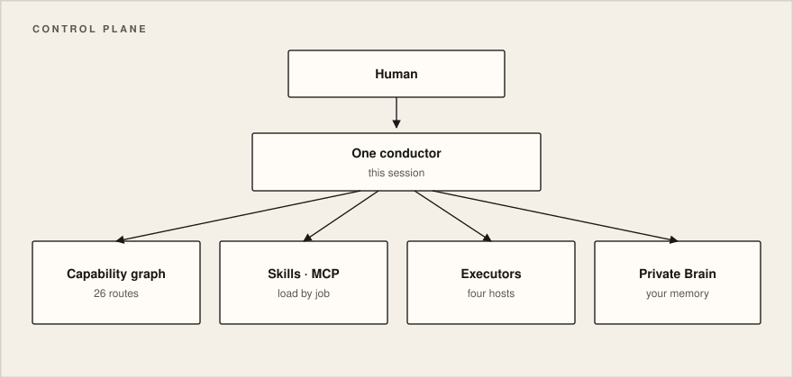
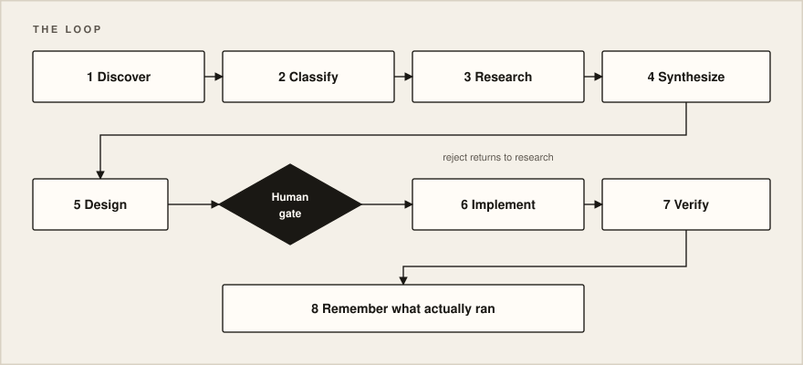
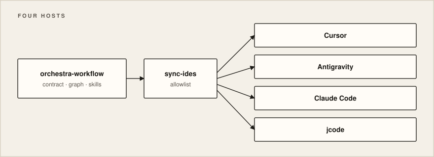
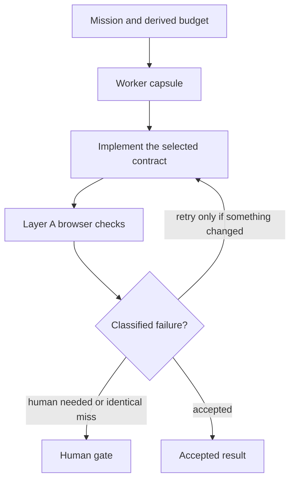

# Orchestra 3.3.2

[](https://github.com/mahik504/orchestra-workflow/actions/workflows/ci.yml)
[](https://github.com/mahik504/orchestra-workflow/actions/workflows/hygiene.yml)
[](LICENSE)
[](https://github.com/mahik504/orchestra-workflow/releases)

A **control plane for agentic development**. One conductor. Four hosts. A capability graph. A human design gate.

Orchestra is a markdown **contract** your agent already knows how to read, plus an optional **Go engine** that enforces the parts a contract cannot. Clone it. Keep products in a private workspace. This repository is the method.

This tree is the **3.3.2 line** through the measurement pilot. The contract pin in `VERSION` is still **`3.3.1`**. That is deliberate. Phase 3I is the version bump and the stable `v3.3.2` tag. Until then, check out `v3.3.1` for the governance release without the engine additions below, and treat a `v3.3.2-*` tag as a prerelease of those additions.

```
ORCHESTRA  = CONTROL PLANE
SKILLS / MCPs / PLUGINS / LIBRARIES = CAPABILITIES
AGENTS     = EXECUTORS
BRAIN      = MEMORY
REGISTRY   = RESOURCE KNOWLEDGE
```

Available ≠ loaded. Registered ≠ active. Discovered ≠ verified.

---

## The problem

Coding agents write files quickly and choose poorly. The default is to dump every skill into the chat, collage every UI kit, skip how the product should look, and call the job done after reading source. Marketplace skill packs make that worse.

Orchestra is built for one person running serious work across Cursor, Antigravity, Claude Code, and jcode without a second conductor, a secret taste pack, or a fake “HEALTHY” label on a server nobody signed into.

---

## How it works

Host rules are **adapters**. They translate syntax. They do not invent a second plan.



The session follows one loop. Backend, research, and documentation jobs collapse the design stage into a technical plan. Visual jobs stop at the human gate before anything a browser renders is written.



```
Understand → Classify → Search graph → Design Lab / Technical plan → HUMAN GATE
  → Implement → Verify on the real app → Correctness review → Simplify review → Remember
```

The same contract is copied to four hosts. Skills come from an allowlist, not from `skills add --all`.



Named *visual* references (live site, screenshot recreation, “feel like X”) do **not** skip Design Lab. They take exactly **3 translations**, then one `DESIGN.md`, then golden stills. A pasted `DESIGN.md` (or a named skill/MCP/pack that already *is* the contract) skips the survey; stills remain unpaid. Tint: keep structure, swap one token, extend the same system.

Full notes: [`ARCHITECTURE.md`](ARCHITECTURE.md). 3.3.2 terms and the mission loop: [`docs/3.3.2/ORCHESTRA_3_3_2_ARCHITECTURE.md`](docs/3.3.2/ORCHESTRA_3_3_2_ARCHITECTURE.md). Extra figures: [`docs/diagrams/`](docs/diagrams/).

### What 3.3.2 adds around that loop

The eight stages stay. 3C wraps a run in a mission, a worker capsule, and a derived budget. Ordinary work stays cheap. Flagship visual work can take a few lightweight directions, then one contract. Layer A is a real browser check. Layer B looks at those captures only when the budget asks. An independent judge is a trigger, not a synonym for “do the expensive path.”



---

## Where 3.3.2 stands

Status tracker: [`docs/3.3.2/ORCHESTRA_3_3_2_AUDIT.md`](docs/3.3.2/ORCHESTRA_3_3_2_AUDIT.md). Requirements: [`docs/3.3.2/ORCHESTRA_3_3_2_ACCEPTANCE.md`](docs/3.3.2/ORCHESTRA_3_3_2_ACCEPTANCE.md). Decisions: [`docs/3.3.2/ORCHESTRA_3_3_2_RECONCILIATION.md`](docs/3.3.2/ORCHESTRA_3_3_2_RECONCILIATION.md).

| Phase | State | What is in this tree |
| --- | --- | --- |
| 3A, 3A.1 | Spec | Research, architecture, acceptance, delta. No runtime. |
| 3B | Applied | Host allowlist matches the repo. 44 skills. Installer reads `registries/host-stack.json`. |
| 3C, 3C.1 | In the engine | Mission, capsule, budget, failure class, recovery, durable run state. |
| 3D, 3D.1 | In the engine | Flagship directions, critic questions, Layer A Playwright, Layer B only on those shots. |
| 3E, 3E.1 | In the engine | `capability.Select`. The capsule consumes the minimum set. Opaque model labels do not route. |
| 3F, 3F.1 | In the engine | Brain notes stay notes. Health does not invent a requirement. A missing Brain file does not stop the run. |
| 3G – 3G.2.4 | Measured | T1 and T3 host pairs. `claim: none`. T2 and T4–T10 stay off. |
| 3H | Not started | Product-class runs compared with representative 3.3.1 behavior. |
| 3I | Not started | KEEP / MIGRATE / DELETE / ARCHIVE, then `VERSION` → `3.3.2`, then the stable tag. |

`claim` for output quality stays **`none`**. Cleaner docs are not success. A finished pair is not proof that a website got better.

---

## Compared with older releases

| | 3.2.0 | 3.3.0 | 3.3.1 | This tree |
| --- | --- | --- | --- | --- |
| Git tag | `v3.2.0` | `v3.3.0` | `v3.3.1` | prerelease only, until 3I |
| Contract pin | 3.2.0 | 3.3.0 | 3.3.1 | still `3.3.1` |
| Capability routes | prior graph | 13, each with a trigger and a skip | 17 | 17 |
| Global skills | 30 | about 40, plus job packs | 44, four of them job-loaded | 44 |
| Design Lab | short directions, then a contract | 23 cards, then one `DESIGN.md` | two locks; named visual refs take exactly 3 translations | same locks; flagship work gets 3–5 lightweight directions, then one build |
| Visual check | ledger and screenshots | screenshots are not a collage | golden stills before product UI | Layer A on a running app; Layer B on those captures when budgeted |
| Run control | eight stages | eight stages | eight stages, visual evidence gate | mission, capsule, derived budget, classified recovery |
| Capability pick | graph route | graph route | graph route | minimum set actually consumed by the stages |
| Benchmark | none in-repo | none | none | T1 API and T3 one-line Go fix. Not a frontend score |

3.3.1 governance notes stay at [`docs/3.3.1/MIGRATION.md`](docs/3.3.1/MIGRATION.md) and [`protocols/VISUAL_GOVERNANCE.md`](protocols/VISUAL_GOVERNANCE.md). Checking out `v3.3.1` does not delete that release. This branch adds files on top of it.

### Quality bars (unchanged)

| Bar | When | Design Lab |
| --- | --- | --- |
| `STANDARD` | Internal tools, fixes, glue, backend | Off unless you opt in |
| `PREMIUM` | Anything a stranger will see | On. Opt out with “skip the lab” |
| `EXPERIMENTAL` | 3D, shaders, WebGL, novel interaction | On. Ship a low-end fallback |

`LIGHT` and `FULL` are intensity, not a fourth bar. A premium product can still take the cheap path for a one-line fix.

Capabilities: `premium-website`, `3d-portfolio`, `operator-hud`, `b2b-portal`, `academic-reader`, `research-paper`, `micro-interactions`, `physics-canvas`, `saas-dashboard`, `mobile-app`, `security-audit`, `reverse-engineering`, `interaction-components`, plus `visual-forensics`, `visual-golden-still`, `fresh-context-review`, `final-showcase`.

`interaction-components` searches registered free kits for **one** control. Inspect existing project components first. It is not a skill per button library.

If the graph has no skill for the job: research a named public page, propose **one** capability, **wait for update**.

Inventory and health (no fake HEALTHY): [`docs/RESOURCE_INVENTORY.md`](docs/RESOURCE_INVENTORY.md) · [`docs/RESOURCE_HEALTH.md`](docs/RESOURCE_HEALTH.md) · [`docs/DESIGN_RESOURCE_ROUTING.md`](docs/DESIGN_RESOURCE_ROUTING.md)

---

## What the measurement actually showed

The harness compared a raw host and Orchestra on two Go fixtures. Both arms used the same Cursor profile. Token counts and host retries were unavailable.

| Pair | Result |
| --- | --- |
| T1, after the fixture was a real stub | Both arms completed. Diff sizes differed. `claim: none`. |
| T3, first pair | Both arms changed only `sum.go`, 183 bytes. The host inherited workspace memory. |
| T3, clean pair | Same 183-byte `sum.go` diff. Walls 104157 ms and 129875 ms. Workspace memory was withheld. Orchestra was the slower arm. |

T3’s task text already says to change the return value. That pair cannot score a website, a 3D scene, or a design. It is a cost observation on a one-line fix.

---

## Still ahead

**3H — product benchmarks.** Run the acceptance classes against representative 3.3.1 behavior. Record quality, reliability, speed, cost, human gates, failures, retries, completion, and overhead. No invented targets. Slightly prettier at several times the cost is not a win unless the operator accepts that cost.

**3I — release hygiene.** Classify leftover 3.1 / 3.2 / 3.3.1 pieces as keep, migrate, delete, or archive, with evidence for every delete. Then bump `VERSION`, hygiene, and the host-stack pin together, and tag stable `v3.3.2` from the maintainer’s terminal.

Not in this line: a model router, a second conductor, a skill pack, or a five-version bake-off with no named artifact.

---

## Design Lab

On `PREMIUM` and `EXPERIMENTAL` visual work, the engine **refuses to write files a browser renders** until a direction is approved.

1. Rebrief and classify.
2. Open-ended PREMIUM: **23 short direction cards**. Named visual refs: **exactly 3 translations**. Pasted `DESIGN.md`: skip survey. Flagship creative work in this tree: **3–5 lightweight directions**, then one sealed contract.
3. Write **one** sourced `DESIGN.md`. Human contract gate → `CONTRACT_APPROVED`.
4. Golden stills (desktop + mobile) → human visual gate → `ApproveStills`. Then implement. A `DESIGN.md` is not visual evidence.

Protocol: [`protocols/DESIGN_LAB_PROTOCOL.md`](protocols/DESIGN_LAB_PROTOCOL.md).

GetLayers MCP is **`PURCHASE_PENDING`**. Do not connect it, fake it, or scrape the paid library. After a Full Stack lifetime purchase, say **update**. Re-check [getlayers.ai/pricing](https://www.getlayers.ai/pricing) before you buy.

### Free portion, used honestly

Use the free slice now. Do not claim a Pro MCP as free.

- **Components:** shadcn (foundation, not identity), React Bits OSS, Magic UI OSS + free MCP, Aceternity public categories, Kokonut, Motion Primitives, Cult UI, HyperUI, Tailkit public pages, 21st catalog (2 installs/day after login)
- **Research:** Godly, Land-book, Lapa Ninja, SaaSFrame, Refero public pages
- **3D:** Three.js, R3F, drei, react-postprocessing, r3f-scroll-rig — project-scoped
- **Motion:** one engine. GSAP for timelines. Do not stack every library
- **Refero MCP / Tailkit MCP:** `AUTH_REQUIRED`. Magic UI Pro, 21st Builder, Aceternity All-Access unpaid this pass

Playwright verifies **our** app. Reading the source is not verification. `DONE` / `FIXED` / `VERIFIED` / `PASSED` / `SHIPPED` only with observed evidence in the same message. Ledger: [`protocols/VERIFICATION_LEDGER_PROTOCOL.md`](protocols/VERIFICATION_LEDGER_PROTOCOL.md).

---

## Getting started

```bash
git clone https://github.com/mahik504/orchestra-workflow.git
cd orchestra-workflow
```

Windows:

```powershell
powershell -NoProfile -ExecutionPolicy Bypass -File kit/bootstrap.ps1
```

macOS / Linux:

```bash
chmod +x kit/bootstrap.sh kit/init-workspace.sh
./kit/bootstrap.sh
```

Bootstrap asks which hosts to wire, creates an empty private workspace, copies the allowlisted skills, writes adapter files, and prints the plugin checklist. Paste your own keys in the host MCP UI. Restart. Talk.

The Go binary is optional. Host auth clicks: [`docs/manual-setup/`](docs/manual-setup/). Walkthrough: [`docs/getting-started.md`](docs/getting-started.md). Rollback: pin `ORCHESTRA_CONTRACT`, or check out `v3.3.1` for the governance release and `v3.3.0` / `v3.2.0` for older contracts — [`kit/ROLLBACK.md`](kit/ROLLBACK.md).

| Variable | Effect |
| --- | --- |
| `ORCHESTRA_HOME` | your private workspace root |
| `ORCHESTRA_CONTRACT` | pin an older contract if a rollout misbehaves |

Say **skip orchestra** and the contract stands down for the session. Say **skip the lab** to bypass Design Lab for one task. Plain text. Not a slash command.

---

## Contributing

This is a methodology template, not an application. Strangers clone the method and fill their own workspace.

**Useful PRs**

- Init and install script fixes
- Clearer docs and host adapters
- Registry rows with license + maintenance evidence
- Protocol clarifications that do not add skill dumps
- Go tests around classify, the Design Lab lock, mission binding, and MCP honesty

**Not useful**

- Skill packs (`--all`, marketplace dumps, “88 devops skills”)
- Always-on UI-kit MCP
- Screenshot-to-code factories
- Personal brains, product briefs, or career notes
- Secrets, `.env`, MCP JSON with keys
- Fake benchmarks (“30% faster”, “zero errors”) without a described measurement

Start with [`CONTRIBUTING.md`](CONTRIBUTING.md). Open an issue for a graph miss or a resource that is documented as free when the MCP is paid.

---

## Honest limits

There is no study in this repository that shows Orchestra produces better websites than the host alone. The T3 pair is a tie on a one-line Go fix, and Orchestra was slower. Token columns without a measured test are guesses — we do not publish them.

- `VERSION` is `3.3.1` until phase 3I. A prerelease tag does not change that pin.
- Research in the Go engine runs **offline by default**. Live sources are opt-in.
- The engine enforces **structure**, not taste.
- Visual QA needs a **running app**.
- Resource memory starts **empty**.
- jcode is an optional executor. Evidence is stdout.
- MCP servers you have not signed in to are `AUTH_REQUIRED`, not `HEALTHY`.
- GetLayers is purchase-pending. It is not connected.
- Live conductor copies on a machine are not hashed by `check-host-stack.js`. Registry and `skills/` are what that check compares.

This repo will never contain anyone’s product briefs, live keys, a populated `projects/` tree, or contribution-graph painting.

---

## Layout

```
AGENTS.md            the contract
.cursorrules         Cursor adapter
CLAUDE.md            Claude Code adapter
protocols/           job-scoped rules
registries/          resources, graph, host-stack
runtime/             Go engine, mission, capability select, Layer A, benchmark harness
skills/              curated global skills
kit/                 host setup, sync, rollback
docs/3.3.1/          governance release notes
docs/3.3.2/          3.3.2 spec, phase reports, audit
docs/diagrams/       figures
templates/           packets and job packs
workspace-template/  empty workspace shape
VERSION              contract pin, still 3.3.1 until 3I
```

---

## License

MIT. See [LICENSE](LICENSE). Copyright (c) 2026 Mahaveer Singh Gehlot.
