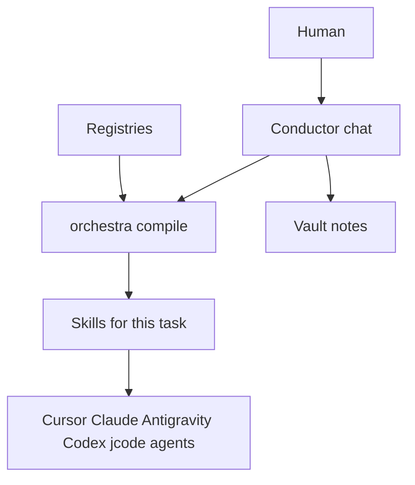
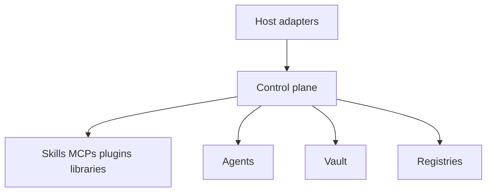
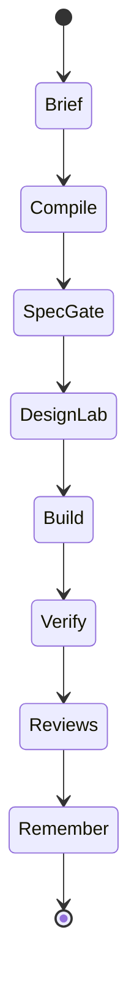
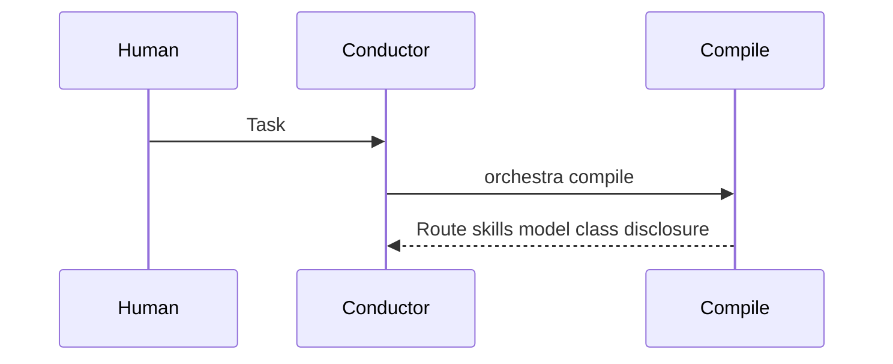
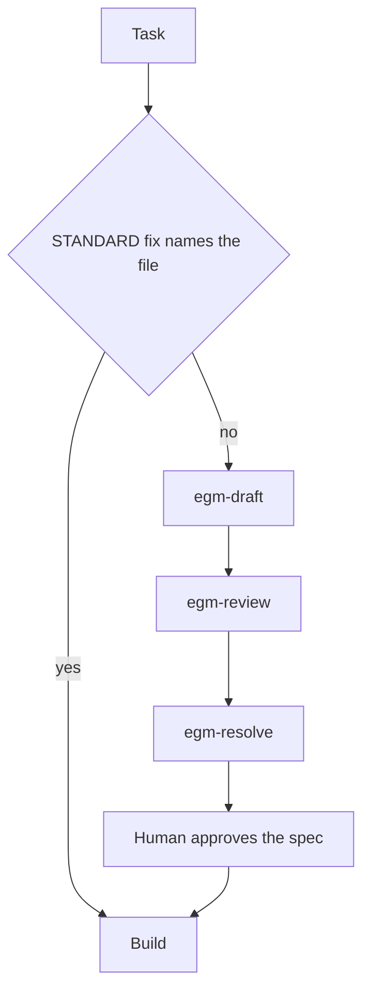
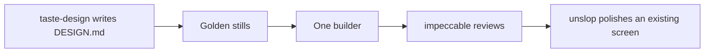
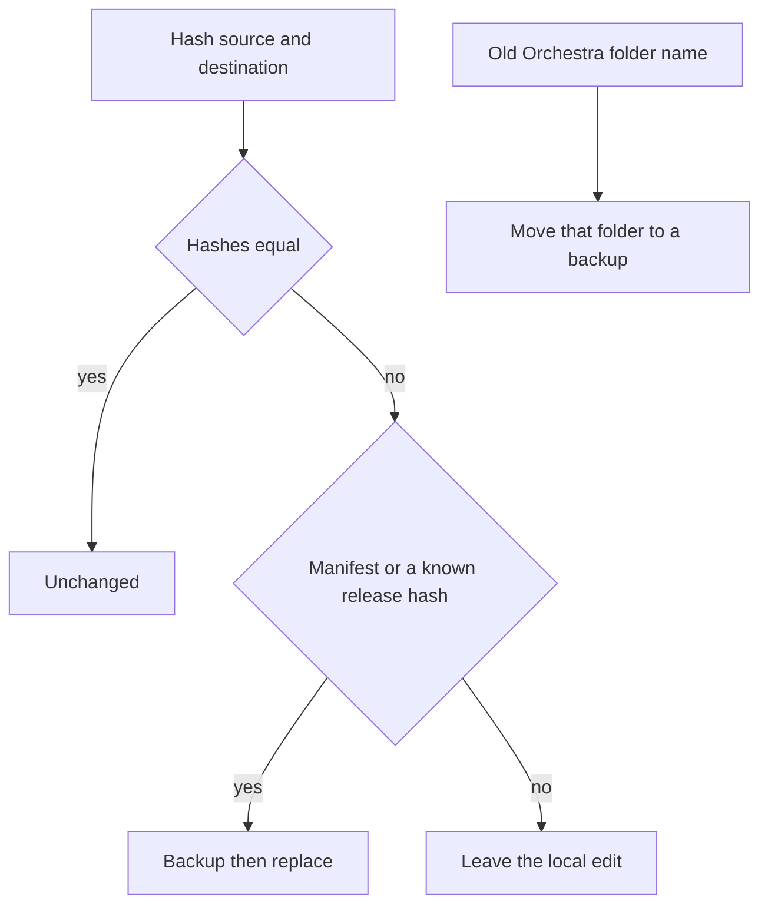
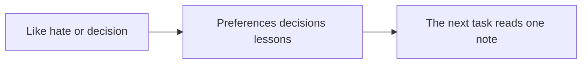
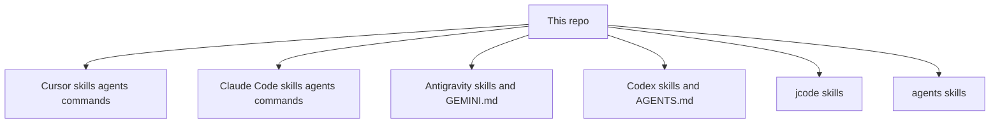
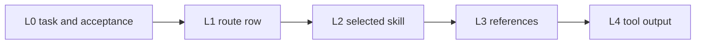

# Orchestra Workflow

Orchestra 5.0.0 is the control plane for Cursor, Claude Code, Antigravity, Codex, jcode, and the agents host. Skills, MCPs, plugins, and libraries are capabilities. Agents execute. The vault remembers. The registries say what exists. Host files are adapters.

The pin in [`VERSION`](VERSION) is **5.0.0**. The 4.7.0 tag stays where it was.

```
ORCHESTRA  = CONTROL PLANE
SKILLS / MCPs / PLUGINS / LIBRARIES = CAPABILITIES
AGENTS     = EXECUTORS
BRAIN      = MEMORY
REGISTRY   = RESOURCE KNOWLEDGE
```

This repository is the method. Products, keys, and taste stay in a private workspace.

[CI](https://github.com/mahik504/orchestra-workflow/actions/workflows/ci.yml) and [Hygiene](https://github.com/mahik504/orchestra-workflow/actions/workflows/hygiene.yml) run on `main`. A badge is a link. The run page is the result.

## What's new in 5.0.0

- Site recon, app recon, scrape, UI assembly, waves, and MCP audit are routes. The eval in [`docs/audit/EVAL-5.0.md`](docs/audit/EVAL-5.0.md) did not run a live model trial. Those skills are not a measured win.
- `orchestra mcp-serve` is an experimental stdio server for compile and a provenance check.
- `compare.go` stays disabled. The claim stays none.

## What's new in 4.7.0

- A handoff is `PREPARED` until a real build runs. Ordinary visual QA that does not apply is `NOT_APPLICABLE`, and that is not a pass.
- `orchestra verify` returns a non-zero exit on FAIL, BLOCKED, or NOT_RUN.
- The route table is [`docs/ROUTING.md`](docs/ROUTING.md). Always-on adapters point at it.
- Project hooks in `kit/hooks/` can deny a dangerous command and a secret read. The default profile warns. It does not turn on strict mode.
- A mobile app route loads the official Expo skills. A website prompt does not take that route.
- No study in this release shows a higher success rate than a raw host. `compare.go` stays disabled.

## What's new in 4.6.0

- One shared rules block, rendered from [`registries/routing.json`](registries/routing.json) into `.cursorrules`, `CLAUDE.md`, and `kit/antigravity/GEMINI.md`. The old lines that named `fullstack-mastery`, `creative-3d-web`, and `r3f-shaders` are gone.
- Sync moves old skill names to a backup. A destination whose hash matches a copy from `v4.0.0`, `v4.1.0`, `v4.5.0`, or commit `60cf9e7` (the 4.2.0 release, which has no tag) can be replaced. A file you edited, whose hash matches none of those, stays.
- Global `CLAUDE.md`, `GEMINI.md`, and Codex `AGENTS.md` are written when the file is already an Orchestra adapter, after a backup. A personal file that does not look like Orchestra is left alone. `GEMINI.md` stays under 24KB.
- Spec review is `egm-draft`, `egm-review`, and `egm-resolve`, vendored from Google's Elephant-Goldfish Model. A STANDARD fix that names the file skips that gate.
- New routes load `unslop`, `build-awwwards-quality-sites`, `floorplan`, `anatomy`, `webapp-testing`, and `mcp-builder` under those upstream names.
- Plugin manifests sit at the repo root for Claude, Cursor, Codex, and Antigravity. On a machine that already uses `ow-sync`, installing the plugin copies the same skills a second time. Use one of the two.
- Every Mermaid fence in this README and in `docs/` is parsed in CI.

## The idea

One person talks to one conductor. That chat loads the route for the task, names the skills, and checks the running app before it calls the work done. Another harness does not open a second plan. A skill you name wins, unless it is unsafe. A missing tool stops. It does not install itself.

`skip orchestra` stands this down for a session. Plain text.

## Context



## Layers



## The loop

`ow-forge` writes a short brief when the job is open. A STANDARD fix that already names the file skips the brief and the spec gate. `orchestra compile` prints the route, the skills, the model class, and the disclosure level. The conductor writes `.orchestra/STATE.md` at each phase: phase, done, constraints, next action. A subagent handoff carries that file.

The Design Lab still blocks product UI on PREMIUM work until the contract and the stills are approved. Execute still stops when a visual review needs a browser and Playwright is missing. `orchestra plan` records that gate and prints the manifest anyway.



## Compile



`orchestra compile --task "..." --host cursor --json` is the command. Keyword length scores the route. A tie at a score above zero prefers the Bug row.

## Spec gate



The reviewer prompts live inside each `egm-*` skill so a host can open them. Goldfish review wants a fresh subagent. The human still approves the spec.

## Design pipeline

`taste-design` writes `DESIGN.md`. One builder runs in a pass. `impeccable` reviews a surface that already exists. `unslop` polishes a screen that already exists. An award-style site loads `build-awwwards-quality-sites`, `taste-design`, `impeccable`, `ow-golden-still`, and the three GSAP scroll skills. One motion owner. One 3D scene, and that scene is `ow-3d-engineering`.



## Sync



```powershell
powershell -NoProfile -ExecutionPolicy Bypass -File kit/sync-ides.ps1
powershell -NoProfile -ExecutionPolicy Bypass -File kit/sync-ides.ps1 -Sync
```

The first command prints a plan. `-Sync` writes. `-Prune` exits 2. `node runtime/tools/ow-sync.mjs` is the tool `orchestra sync` calls. Backups go under `%LOCALAPPDATA%\orchestra\backups` on Windows, or `~/.local/state/orchestra/backups` elsewhere. `OW_BACKUP_ROOT` overrides that.

## Memory

A like, a hate, or a decision is written the same turn into `Preferences.md`, `decisions.md`, or `lessons.md` in the private vault. The next task reads one matching note. That is the memory. The model weights stay as the vendor shipped them.



## Hosts



The path table is [`docs/hosts.md`](docs/hosts.md). Which skill a route loads, and when to skip it, is [`docs/skills.md`](docs/skills.md).

## Disclosure



Load the level the route names. Leave the rest unloaded.

## How it was built

| Version | What landed |
| --- | --- |
| 1.0.0 | The first workflow repo |
| 2.0.0 | A second pass at the same method |
| 3.0.0 through 3.3.6 | The control plane, the design gate, host adapters, and green release checks |
| 4.0.0 | Routes in a table the hosts share |
| 4.1.0 | The receipt names what a task loaded |
| 4.2.0 | Five skills, plugins that would open a second plan stay off. Commit `60cf9e7`, no tag |
| 4.5.0 | Orchestra-owned skills renamed to `ow-*`, hash sync, `orchestra compile`, no skill-slot cap |
| 4.6.0 | Spec review, the six upstream skills above, sync of agents and adapters, plugin manifests, a Mermaid parse check |

## Benchmarks

On 2026-11-08 three bugfix trials ran on `composer-2.5-fast`. In every trial both the raw arm and the Orchestra arm changed `Add` from `a + b + 1` to `a + b`, and `go test` passed. The records are [`runtime/benchmarks/c6-bugfix.json`](runtime/benchmarks/c6-bugfix.json) and the three files under [`runtime/benchmarks/c6-bugfix/`](runtime/benchmarks/c6-bugfix/). The arms tied. `c6` stays disabled in `compare.go`.

The landing comparison is in [`runtime/benchmarks/c1-premium-landing.json`](runtime/benchmarks/c1-premium-landing.json). Three trials on `composer-2.5-fast`. The Orchestra workspace had `AGENTS.md`, `.cursorrules`, and the compile manifest. The raw workspace was told skip orchestra and had no `AGENTS.md`. Every arm built. Layer A captured desktop and mobile. Lighthouse used the desktop preset. Performance was 100, 99, and 99 on the raw arm, and 99, 98, and 99 on the Orchestra arm. Accessibility was 100, 96, and 100 on the raw arm, and 100 on every Orchestra arm. Axe found `landmark-one-main` and `region` on the second raw page and nothing on the other five. A blind judge called the first trial a tie and preferred the Orchestra page on the other two. Both arms could see the global skills. One Orchestra attempt wrote no files and was rerun. Two Orchestra agents were stopped after the production build was on disk. `c1` stays disabled in `compare.go`.

## Other harnesses

Superpowers skills that we use are vendored. The plugin stays off. GSD, gstack, BMAD, ECC, Spec Kit, and the Elephant-Goldfish plugin were opened at the commits in [`docs/evaluations/harnesses.md`](docs/evaluations/harnesses.md). They did not become a second conductor. The four EGM skills we use are copied into `skills/` with a `NOTICE` in each folder. `egm-brainstorm`, `egm-bootstrap`, and `egm-drift-report` were left out. taste-skill and the Trail of Bits pack were evaluated and not installed.

## Install

Clone the repo and sync. This does not install a global skill pack.

```powershell
git clone https://github.com/mahik504/orchestra-workflow.git
cd orchestra-workflow
powershell -NoProfile -ExecutionPolicy Bypass -File kit/install-git-hooks.ps1
powershell -NoProfile -ExecutionPolicy Bypass -File kit/sync-ides.ps1
powershell -NoProfile -ExecutionPolicy Bypass -File kit/sync-ides.ps1 -Sync
```

On macOS or Linux, `kit/sync-ides.sh` is the dry run and `kit/sync-ides.sh --apply` writes.

### Master prompt

Paste this into Cursor, Antigravity, or Claude Code once. It installs this method. It does not train a model.

```
You are running Orchestra. AGENTS.md in the orchestra-workflow clone is the contract.
Clone https://github.com/mahik504/orchestra-workflow.git if it is not already on disk.
Run kit/sync-ides.ps1 on Windows, or kit/sync-ides.sh on macOS or Linux, and show the plan.
After I confirm, run the apply form. That copies skills, agents, commands, and the Orchestra adapters, and it adds the core MCP servers that do not need a key.
Ask before installing Obsidian. On Windows the command is: winget install --id Obsidian.Obsidian -e
On macOS the command is: brew install --cask obsidian
After I confirm, create a private vault from workspace-template/ and open that folder in Obsidian.
Learning means Preferences.md, decisions.md, and lessons.md. Write one when I like something, hate something, or make a decision. Read the matching note at the start of the next task.
Do not run npx skills add --all. Do not commit a key. Do not install a second conductor.
```

### Plugin install

Use these when you are not using `ow-sync` on that machine. Using both copies every skill twice.

- Claude Code: `claude plugin marketplace add mahik504/orchestra-workflow` then `claude plugin install orchestra@orchestra`
- Cursor: install `mahik504/orchestra-workflow` from the plugin page. The repo contains `.cursor-plugin/marketplace.json`.
- Codex: the manifest is `.codex-plugin/plugin.json`
- Antigravity: the manifest is `.plugin/plugin.json` and the marketplace file is `.agents/plugins/marketplace.json`

## Use

`docs/skills.md` lists each skill, the route that loads it, and the skip line. `orchestra compile --task "the task" --host cursor --json` prints the choice for one sentence. `orchestra doctor` checks the hosts. Add `-Private` only on the machine that has the vault.

## Uninstall

Delete the skill folders listed in `.ow-manifest.json` inside each host skill directory. Folders that are not in that manifest are yours. Leave them. Alias folders that sync moved are in the backup directory named above.

Remove the block between `<!-- orchestra:start -->` and `<!-- orchestra:end -->` from `AGENTS.md`, `CLAUDE.md`, `GEMINI.md`, or `.cursorrules`.

## Credits

Mahaveer Singh Gehlot. Upstream licenses and the commits we copied are in [`THIRD_PARTY_NOTICES.md`](THIRD_PARTY_NOTICES.md) and [`docs/evaluations/upstream.md`](docs/evaluations/upstream.md).
