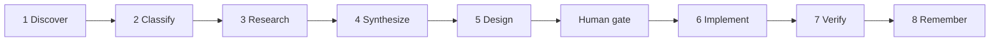
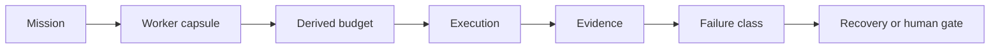
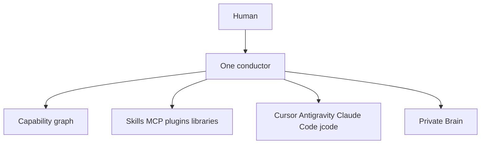
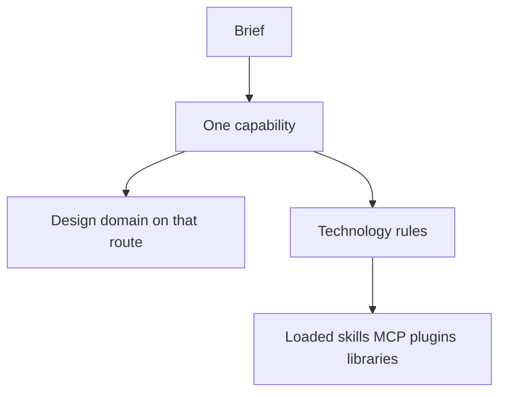
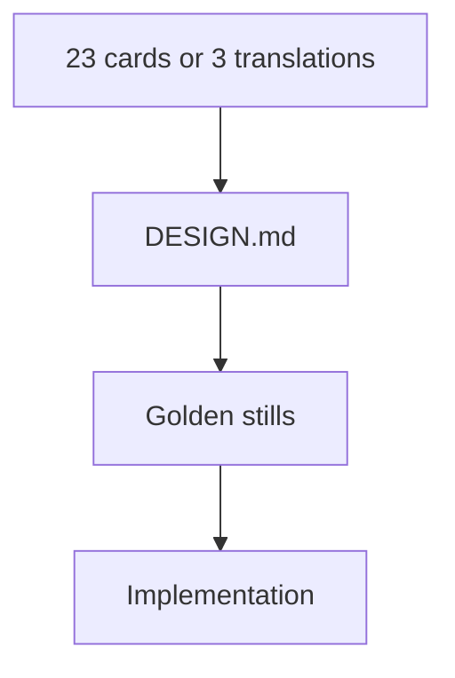
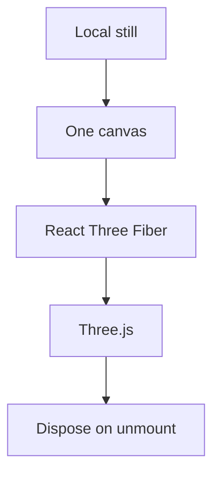
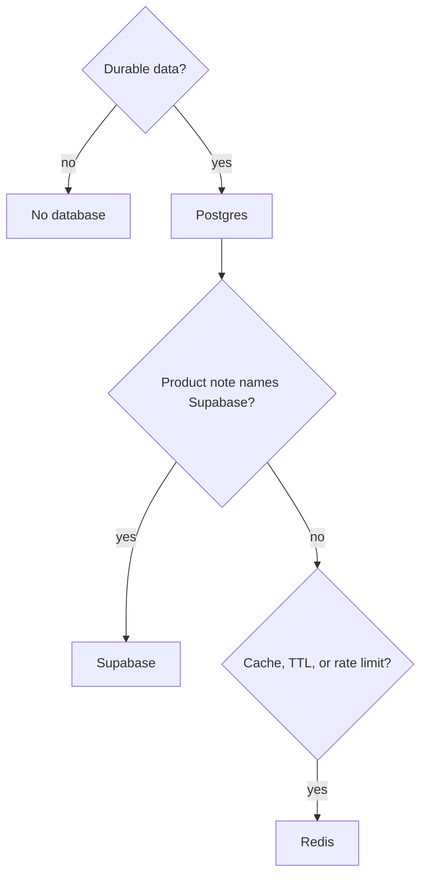

# Orchestra Workflow

An intelligent, provider-neutral control plane for agentic development. One conductor. The same skills on Cursor, Antigravity, Claude Code, and jcode. A human gate before showable UI.

[](https://github.com/mahik504/orchestra-workflow/actions/workflows/ci.yml)
[](https://github.com/mahik504/orchestra-workflow/actions/workflows/hygiene.yml)
[](LICENSE)
[](https://github.com/mahik504/orchestra-workflow/releases)

The pin in [`VERSION`](VERSION) is **4.1.0**.

```
ORCHESTRA  = CONTROL PLANE
SKILLS / MCPs / PLUGINS / LIBRARIES = CAPABILITIES
AGENTS     = EXECUTORS
BRAIN      = MEMORY
REGISTRY   = RESOURCE KNOWLEDGE
```

This repository is the method. Products, keys, and taste stay in a private workspace.

## What Orchestra is

Orchestra tells the agent which skills, MCP servers, plugins, and libraries belong to this job. A registry row is knowledge. It is loaded only when the route selects it. A skill you name wins unless it is unsafe next to the route that already owns the work. A missing tool stops. It does not install itself.

When the task loads nothing new, the agent does not print an empty routing note.

## Why it exists

A host agent loads whatever skills happen to be in context. A bug then opens a design survey, and a landing page loads every component kit. Orchestra classifies one route from [`registries/design-resource-graph.json`](registries/design-resource-graph.json) and loads that route.

Showable UI waits for a design contract and golden stills. Bugs, APIs, and college work skip that gate unless you say otherwise.

## How a job runs

```
Understand → Classify → Load the route → Design Lab or a technical plan → HUMAN GATE
  → Implement → Verify on the running app → Review twice → Remember
```




The engine wraps that loop with a mission, one worker capsule, and a budget derived from the task. Ordinary work stays small. A flagship page can take a few directions, then one contract.



Capsule roles are planner, builder, and judge. The acceptance line moves when you change it. A retry needs budget remaining and a real change. The same failure replayed unchanged stops. A missing credential, a brand choice, or a conflict in the contract stops for you.

Playwright checks the running app. The model dropdown stays yours. Orchestra does not turn a model name into a skill list.

## What's new in 4.1.0

4.0.0 already had the eight stages, the 26-route graph, the design gate, 73 skills, and host sync. 4.1.0 adds selection on that same conductor.

- The routing note names skills, MCPs, plugins, and libraries only when the task loads them.
- Design domains annotate existing routes: premium sites, editorial, shops, portfolios, 3D, shaders, SaaS, dashboards, and mission control. Responsive layout is a gate on the parent route.
- Technology rules keep one scroll owner, one scene, one HTTP stack, and one bundler. Redis, a queue, Supabase, Lenis, Theatre.js, and a scroll rig are selected when the brief needs them.
- [`templates/contracts/`](templates/contracts/) is the design pack. A bug, a typo, or one control does not generate it.
- Review lenses are requirements, build, visual, architecture, security, performance, and simplify. A typo stays with the builder. A visual judge needs a screenshot from the run.

No new skill folder. The cap stays 80. No new package in this repo.

## Compared with earlier releases

| | 3.3.6 | 4.0.0 | 4.1.0 |
| --- | --- | --- | --- |
| Contract | One `AGENTS.md`. `Load` and `Skip` required before a write | Same contract. Eight more skills. 73 canonical skills. Cap 80 | Same contract. The note lists only what this task loads |
| Routes | Job table copied into the host files | The graph names the skill folders. An unhealthy required tool stops | Domains and technology rules sit on those routes |
| Design | Kind sets the bar. College skips the lab unless you say PREMIUM | One component source, in a fixed order. A catalog is not a motion runtime | Contract templates in `templates/contracts/`. Golden stills still come first |
| Hosts | Cursor, Antigravity, Claude Code, jcode | Same four. No new global MCP | Same four. Limitless Claude stays a separate repo |
| Check | CI and Hygiene green on that release | Routing check matches the job cell | Same checks, plus design-domain and technology-policy checks |

Older tags remain: `v3.3.6`, `v3.3.1`, `v3.3.0`, `v3.2.0`. The phase write-ups that used to live under `docs/3.3.*` are not in this tree. [`CHANGELOG.md`](CHANGELOG.md) is the record.

## Compared with other harnesses

| | What it does | Where Orchestra differs |
| --- | --- | --- |
| Raw Cursor, Antigravity, or Claude Code | The host writes from the prompt and whatever skills are already in context | Orchestra names the skills for this job, keeps one conductor, and blocks showable UI until you approve stills |
| [Superpowers](https://github.com/obra/superpowers) | A methodology plugin. Useful as a worker for planning habits | It does not replace `AGENTS.md`. If it starts a second plan, the contract wins |
| Ralph Loop | Repeats until a stop condition | It must not bypass the design gate or become the conductor |
| [Limitless Claude](https://github.com/mahik504/limitless-claude) | Routes model providers for Claude Code through a local gateway. Published line 7.0.0 | Orchestra decides which skills load. Limitless decides which provider answers. Credentials stay in that project |
| This repo | The method, the skill folders, and the engine | Your products, keys, and taste stay in a private workspace |

The one saved paired measurement in this repo is a one-line Go fix. Both arms made the same 183-byte change. Orchestra took longer. That pair does not score a website.

## Architecture



| Piece | Where |
| --- | --- |
| Contract | [`AGENTS.md`](AGENTS.md) |
| System design | [`ARCHITECTURE.md`](ARCHITECTURE.md) |
| Adapters | [`.cursorrules`](.cursorrules), [`CLAUDE.md`](CLAUDE.md), [`kit/antigravity/`](kit/antigravity/) |
| Routes | [`registries/design-resource-graph.json`](registries/design-resource-graph.json) |
| Design domains | [`registries/design-domains.json`](registries/design-domains.json) |
| Technology rules | [`registries/technology-policy.json`](registries/technology-policy.json) |
| MCP call rules | [`registries/mcp-contracts.json`](registries/mcp-contracts.json) |
| Resource catalog | [`registries/resources.json`](registries/resources.json) |
| Engine | [`runtime/`](runtime/) |
| Skills | [`skills/`](skills/) |
| Protocols | [`protocols/`](protocols/) |
| Figures | [`docs/diagrams/`](docs/diagrams/) |

A resource moves one step at a time: discovered, installed, available, selected, executed, verified, successful. A catalog row stays at discovered until a run records evidence.



More figures: [`docs/diagrams/system.md`](docs/diagrams/system.md) and the eight notes in [`docs/diagrams/`](docs/diagrams/).

## Routes

The graph has 26 capabilities. A restaurant page, a school dashboard, and a 3D portfolio resolve to three different routes.

| Job | Route | What loads |
| --- | --- | --- |
| A public brand page | `premium-website` | impeccable, taste-design, visual-golden-still, GSAP |
| A school or metrics dashboard | `saas-dashboard` | backend-architecture, test-driven-development |
| A spatial scene | `3d-portfolio` | r3f-shaders |

The full job table is in [`AGENTS.md`](AGENTS.md): a bug, a paper, a deck, one control, a diagram, a TypeScript review, a deployed app, recent public sources, marketing copy, a rendered video, career notes. One control loads no specialist. Components already in the project come first, then one catalog. GSAP is for scroll.

## Design

Premium and experimental visual work writes [`templates/contracts/DESIGN.md`](templates/contracts/DESIGN.md), then golden stills, then code.



Open-ended premium work uses 23 short cards. A named reference gets three translations. A pasted contract skips the survey. Stills are still required.

The contract covers brand, type, color, space, breakpoints, components, motion, scroll, cursor, 3D, shaders, accessibility, and the budgets for that page. Take principles from references. Leave their logo, copy, and source files alone.

The premium route refuses Inter or Space Grotesk on a creative headline, an equal three-column card grid, a purple gradient as the brand, repeated glass, decorative blobs, and a 3D object that does not explain the product.

## Frontend and 3D

| Need | Choice |
| --- | --- |
| A document | HTML and CSS |
| A small script | JavaScript |
| A production app | TypeScript |
| Components | React |
| Server rendering and SEO | Next.js |
| A client bundle you named | Vite |
| A content site | Astro |
| Scroll, pin, scrub | GSAP |
| Hover, layout, drag | Motion for React |
| Smooth scroll, when asked | Lenis, sharing one scroller with ScrollTrigger |
| A scene in React | React Three Fiber. Three.js is that scene's renderer |
| Controls for that scene | Drei |
| A custom GPU effect | GLSL |
| The deliverable is a Framer file | Framer, separate from the application repo |

GSAP owns scroll. Motion does not drive that same container. One canvas. Device pixel ratio stays between 1 and 2 unless the contract sets a tighter cap. The scene disposes geometries, materials, textures, and the renderer on unmount. Reduced motion and a failed WebGL context keep a local still. Scenes target WebGL 2.



The Next.js starter at [`templates/starters/next-react`](templates/starters/next-react) has lint, typecheck, build, and a Lighthouse job that warns.

## Backend and data

Write the shape before the handlers: tables, keys, constraints, indexes, who can call each route, how bad input is rejected, and which fields are never logged.



| Store | When |
| --- | --- |
| Postgres | Relational data that must survive a restart |
| Supabase | The product note already names it |
| Redis | A cache, a TTL, or a rate limit |
| Express | A small HTTP API the repo does not already serve |
| FastAPI | Python inference or data processing |
| BullMQ | A background job that already needs Redis |
| Node | The TypeScript server |

`supabase` and `postgres-best-practices` load when that product uses them.

## Mobile, research, and documents

Expo skills cover a React Native app: routing, native UI, data fetching, a dev client, upgrades, and store submit. An iOS device build needs a Mac and Xcode. Android uses the SDK on the machine that builds it.

A paper loads `research-paper` and `humanizer`. Citations get checked. A deck loads `orchestra-docs` and `orchestra-presentation`. Word, PowerPoint, PDF, and Excel skills stay on the host. They are not copied into `skills/`.

An ML fine-tune loads `ml-experiment` and reports the eval from that run. `rea` runs on a binary or APK when Java is installed and the target is yours, a client's, a CTF, or open source.

## Quality

Playwright walks the running app. The harness lives in `runtime/` and uses the project Playwright library plus Chromium. Lighthouse is the performance budget for that project. axe-core is the violation list on the running page. Golden stills are the visual contract. Later UI changes compare against those stills. Mask clocks, random ids, and canvases that are not the subject.

Correctness and simplify are two passes.

## Brain

Set `ORCHESTRA_VAULT` to your private notes. The vault holds taste, decisions, and one lesson line per finished session. This clone does not contain it. A decision note starts from [`templates/memory/decision.md`](templates/memory/decision.md).

## Hosts


| Host | Role | Adapter |
| --- | --- | --- |
| Cursor | Usual conductor | [`.cursorrules`](.cursorrules) |
| Antigravity | Visual QA | [`kit/antigravity/`](kit/antigravity/) |
| Claude Code | Terminal and review | [`CLAUDE.md`](CLAUDE.md) |
| jcode | Same skills, fourth executor | [`templates/jcode-omniroute-packet.md`](templates/jcode-omniroute-packet.md) |

Sign in to GitHub, Playwright, and Context7 in the host UI. Tokens stay there. Core MCP templates are in [`registries/host-stack.json`](registries/host-stack.json): vault files, Stitch, Playwright, Context7. Firecrawl and Serena run when that job has already enabled them.

Manual steps that only a person can do: [`docs/manual-setup/`](docs/manual-setup/).

## Install

You need Git. Go 1.22 runs the engine. Node runs the hygiene checks and the Next starter.

```bash
git clone https://github.com/mahik504/orchestra-workflow.git
cd orchestra-workflow
```

### Windows

```powershell
powershell -NoProfile -ExecutionPolicy Bypass -File kit/bootstrap.ps1
```

Bootstrap asks which hosts to wire and copies `skills/` onto them. To refresh skills after a pull:

```powershell
powershell -NoProfile -ExecutionPolicy Bypass -File kit/sync-ides.ps1 -Sync
```

Non-interactive:

```powershell
powershell -NoProfile -ExecutionPolicy Bypass -File kit/bootstrap.ps1 -Hosts cursor,antigravity,claude -Target "$env:USERPROFILE\orchestra-workspace"
```

### macOS and Linux

```bash
chmod +x kit/bootstrap.sh kit/init-workspace.sh kit/install-local-engine.sh
./kit/bootstrap.sh
```

Or name the hosts:

```bash
./kit/bootstrap.sh --hosts cursor,antigravity,claude --target "$HOME/orchestra-workspace"
```

Run the same command again after a pull to refresh those skill folders. The engine binary, if you want it on `PATH`:

```bash
./kit/install-local-engine.sh
```

### After install

Set `ORCHESTRA_VAULT` to your private notes folder. Restart the IDE. The next chat in this repo reads [`AGENTS.md`](AGENTS.md).

Walkthrough: [`docs/getting-started.md`](docs/getting-started.md).

Say **skip orchestra** to stand down for the session. Say **skip the lab** to bypass the design gate for one task.

### First task

Open the product repo. Say what it is and who it is for. The conductor classifies one route and names what it loads. For a public page, approve the contract and the stills before implementation. For a bug, it loads `systematic-debugging` and skips the lab.

## Test

From `runtime/`:

```bash
go test ./...
```

From the repo root:

```bash
node runtime/tools/hygiene.js
node runtime/tools/check-registry.js
node runtime/tools/check-routing.js
node runtime/tools/check-41.js
node runtime/tools/check-design-contract.js templates/contracts spatial
```

CI on `main` and on pull requests runs `go test`, `gofmt -l`, and a JSON check. [Hygiene](.github/workflows/hygiene.yml) is a separate workflow. Live browser tests run when `runtime/node_modules` has the Playwright library and Chromium. Without that install they are skipped.

## Security

Secrets stay in the host. Hygiene rejects credential-shaped strings, private vault paths, and personal product names in tracked files. The engine blocks a global package install. `ship-safe` loads when a change touches auth, public routes, or secrets. Details: [`docs/security-and-privacy.md`](docs/security-and-privacy.md).

## Documentation

| Doc | What it is |
| --- | --- |
| [`AGENTS.md`](AGENTS.md) | The contract and the job table |
| [`ARCHITECTURE.md`](ARCHITECTURE.md) | Stages, mission, gates |
| [`WORKFLOW.md`](WORKFLOW.md) | How a session runs |
| [`docs/getting-started.md`](docs/getting-started.md) | Clone, bootstrap, vault |
| [`docs/workflow.md`](docs/workflow.md) | Short pointer at the loop |
| [`docs/using.md`](docs/using.md) | Day-to-day use |
| [`docs/prompting.md`](docs/prompting.md) | What to say in the brief |
| [`docs/diagrams/`](docs/diagrams/) | SVG figures and Mermaid sources |
| [`docs/DESIGN_RESOURCE_ROUTING.md`](docs/DESIGN_RESOURCE_ROUTING.md) | One design system per job |
| [`docs/RESOURCE_INVENTORY.md`](docs/RESOURCE_INVENTORY.md) | How the catalog is organized |
| [`docs/RESOURCE_HEALTH.md`](docs/RESOURCE_HEALTH.md) | What "healthy" means for an MCP |
| [`docs/security-and-privacy.md`](docs/security-and-privacy.md) | Secrets and scope |
| [`docs/adapters.md`](docs/adapters.md) | Which host conducts |
| [`protocols/`](protocols/) | Design lab, type, visual QA, security |
| [`CHANGELOG.md`](CHANGELOG.md) | Release record |
| [`kit/ROLLBACK.md`](kit/ROLLBACK.md) | Pin or check out an older tree |
| [`CONTRIBUTING.md`](CONTRIBUTING.md) | What to send |

## Migration from 4.0.0

```bash
git pull origin main
```

Capability ids are unchanged. Existing resource rows still load. Refresh host skills with the install commands above.

`ORCHESTRA_CONTRACT` changes the label the doctor prints. The 4.1 selector is code in the tree you checked out. To run 4.0.0 behavior, check out that tag and refresh skills from it.

```powershell
$env:ORCHESTRA_CONTRACT = "4.0.0"
```

```bash
export ORCHESTRA_CONTRACT=4.0.0
```

Do not force-push `main`. See [`kit/ROLLBACK.md`](kit/ROLLBACK.md).

## Contributing

Useful changes are an install fix, a registry row with a license, and a test around the design gate or the routing check. Leave out skill dumps, secrets, and personal notes. See [`CONTRIBUTING.md`](CONTRIBUTING.md).

## Limits

- One conductor. A second plan loses.
- The model dropdown is yours.
- Visual QA needs a running app.
- An MCP you have not signed in to is not connected.
- GetLayers stays purchase-pending until you buy it and say to update.
- iOS device builds need a Mac and Xcode.
- Swift, Kotlin, and Flutter are outside this skill set.

## License

MIT. See [LICENSE](LICENSE).
