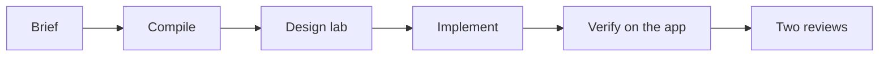
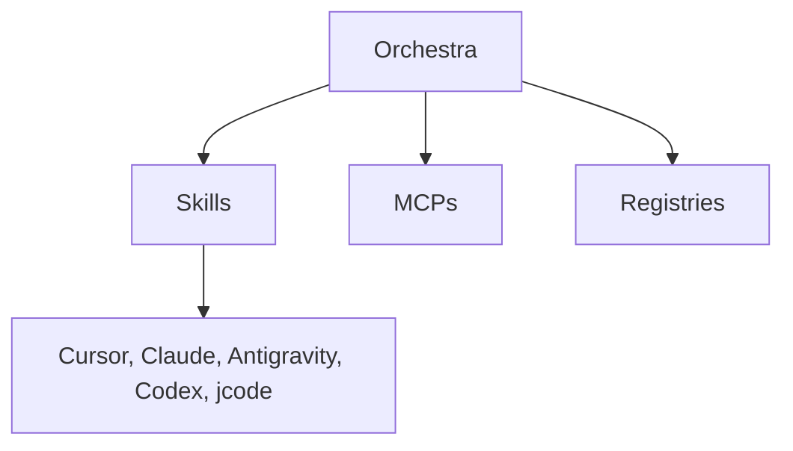
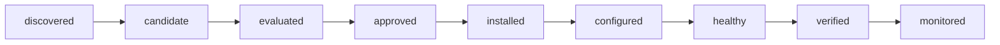
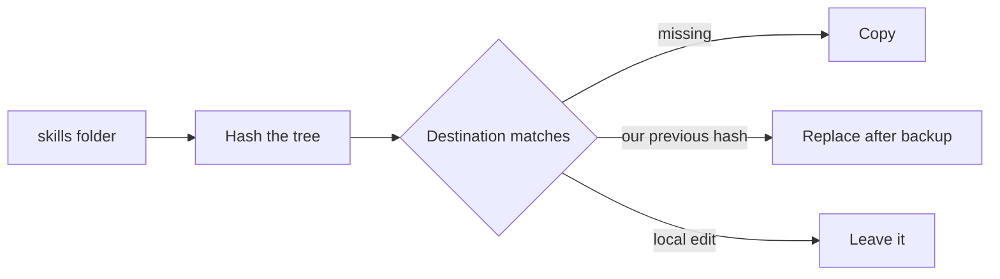
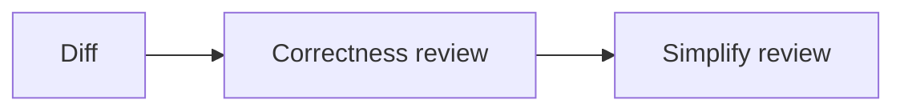
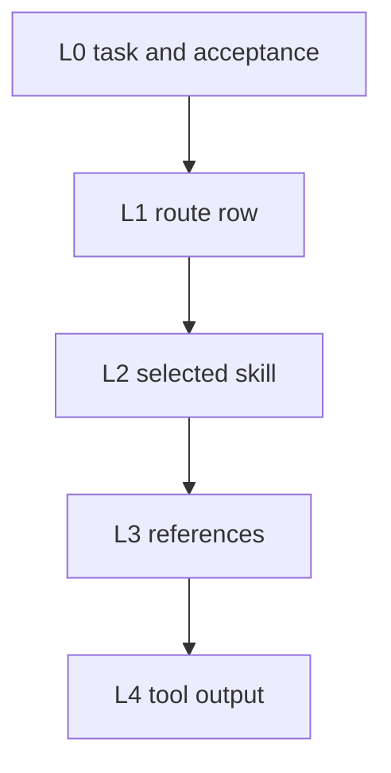
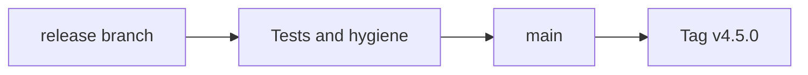

# Orchestra Workflow

<p align="center">
  
</p>

Orchestra 4.5.0 is the control plane for this workspace. Skills, MCPs, plugins, and libraries are capabilities. Agents execute. The vault remembers. The registries say what exists. Host files are adapters.

The pin in [`VERSION`](VERSION) is **4.5.0**.

```
ORCHESTRA  = CONTROL PLANE
SKILLS / MCPs / PLUGINS / LIBRARIES = CAPABILITIES
AGENTS     = EXECUTORS
BRAIN      = MEMORY
REGISTRY   = RESOURCE KNOWLEDGE
```

This repository is the method. Products, keys, and taste stay in a private workspace.

[CI](https://github.com/mahik504/orchestra-workflow/actions/workflows/ci.yml) and [Hygiene](https://github.com/mahik504/orchestra-workflow/actions/workflows/hygiene.yml) run on `main`. A badge is a link. The run page is the result.

## What's new in 4.5.0

- The current version lives in [`registries/versions.json`](registries/versions.json). Check scripts read it.
- Orchestra-owned skills are `ow-*`. Old ids are in [`registries/skill-aliases.json`](registries/skill-aliases.json). GSAP, Expo, Stitch, Superpowers, and the other upstream skills kept their names.
- [`registries/skills.json`](registries/skills.json) is the skill list: owner, license, hosts, and description length.
- `kit/sync-ides.ps1` copies through `runtime/tools/ow-sync.mjs`. A skill you edited locally stays. `-Prune` is refused.
- `orchestra compile --task "..." --host cursor --json` prints the route, the skills, the model class, and the disclosure level.
- `find-skills` is vendored from vercel-labs/skills (MIT, commit `d3701c11`). `ow-skill-advisor` does not run a global install unless you insist, and then it records the install.
- Codex, OpenCode, and Kimi have adapters under `kit/`. The routing table is rendered from [`registries/routing.json`](registries/routing.json).

## How a task moves

`ow-forge` writes a short brief when the job is open. A STANDARD fix that already names the file skips the brief. `orchestra compile` prints the manifest. The Design Lab still blocks product UI on PREMIUM work until the contract and the stills are approved. Execute still stops when a visual review needs a browser and Playwright is missing. `orchestra plan` records that gate and prints the manifest anyway.









```mermaid
flowchart LR
  task[Task text] --> route[routing.json]
  route --> manifest[JSON manifest]
  manifest --> class[Model class]
```







The eight diagrams above are the mermaid source. [`render-readme-diagrams.mjs`](docs/diagrams/assets/render-readme-diagrams.mjs) still writes the three paper figures in [`docs/diagrams/assets/`](docs/diagrams/assets/).

## Benchmarks

On 2026-11-08 three bugfix trials ran on `composer-2.5-fast`. In every trial both the raw arm and the Orchestra arm changed `Add` from `a + b + 1` to `a + b`, and `go test` passed. The records are [`runtime/benchmarks/c6-bugfix.json`](runtime/benchmarks/c6-bugfix.json) and the three files under [`runtime/benchmarks/c6-bugfix/`](runtime/benchmarks/c6-bugfix/). The arms tied. Neither arm gets a win.

The landing comparison is in [`runtime/benchmarks/c1-premium-landing.json`](runtime/benchmarks/c1-premium-landing.json). Three trials on `composer-2.5-fast`. Every arm built, Layer A captured desktop and mobile, axe reported no violations, and Lighthouse accessibility was 100. Performance was 97, 98, and 99 on the raw arm, and 93, 100, and 99 on the Orchestra arm. A blind judge preferred the Orchestra page twice and called the third a tie. That is not a win. `c1` stays disabled in `compare.go`.

## Other harnesses

Superpowers skills that we use are vendored. The plugin stays off. GSD, gstack, BMAD, ECC, and Spec Kit did not become a second conductor. Notes with the commits we actually opened are in [`docs/evaluations/`](docs/evaluations/).

## Versions

| | 4.1.0 | 4.2.0 | 4.5.0 |
| --- | --- | --- | --- |
| Conductor | one | one, plugins off | one |
| Receipt | prints loaded lines | same | same, and `orchestra compile` |
| Skills | allowlist | 78, five added | `ow-*` for Orchestra skills, manifest, no slot cap |
| Sync | delete and copy | delete and copy | hash, conflict skip, backup |
| Benchmark claim | none | none | none |

## Install

[`INSTALL.md`](INSTALL.md) has the clone, the sync, the one-line paste for a host that does not read `AGENTS.md`, and the uninstall. [`docs/migration-4.5.md`](docs/migration-4.5.md) is the move from 4.2.0. [`docs/hosts.md`](docs/hosts.md) lists Cursor, Claude Code, Antigravity, Codex, OpenCode, Kimi, and jcode.

```powershell
powershell -NoProfile -ExecutionPolicy Bypass -File kit/sync-ides.ps1
powershell -NoProfile -ExecutionPolicy Bypass -File kit/sync-ides.ps1 -Sync
```

## Learn

[Working](docs/learn/working.md), [design](docs/learn/design.md), [motion](docs/learn/motion.md), [3D](docs/learn/3d.md), [deploy](docs/learn/deploy.md), [research](docs/learn/research.md), [presentations](docs/learn/presentations.md), [README](docs/learn/readme.md), [reverse engineering](docs/learn/reverse.md), [hackathons](docs/learn/hackathon.md), [brainstorm](docs/learn/brainstorm.md), [coach](docs/learn/coach.md). Skill and MCP authoring sit beside those pages.

## Credits

Mahaveer Singh Gehlot. Upstream licenses are in [`THIRD_PARTY_NOTICES.md`](THIRD_PARTY_NOTICES.md). The default mark is `assets/brand/ow-mark-bars.svg`. Two alternates sit beside it.

Say **skip orchestra** to stand this down for a session.
