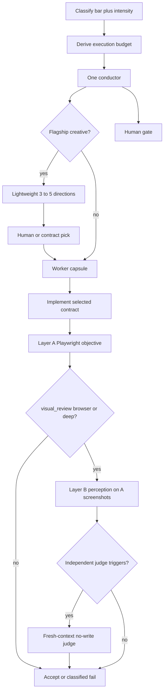

# Orchestra 3.3.2 — architecture

Governance plus a few missing mechanisms. **Does not replace the 3.3.1 OS.**

The contract pin in `VERSION` remains `3.3.1` until 3I. The mechanisms below are already in this tree. A prerelease tag is not the stable `v3.3.2` release, and it is not an effectiveness claim. **3C is locked.** **3D is locked.** **3D.1** adds a project-local Playwright library + Chromium under `runtime/` so Layer A can capture real pixels. **3E** adds `capability.Select` (minimum set consumed by existing stages). **3F** reconciles Brain with that runtime. **3G** is a T1/T3 measurement pilot. **3G.1** adds the host-pair harness on those fixtures. Later 3G.2 passes corrected the T1 fixture and reran T3 with workspace memory withheld. A missing host stays unavailable, and a finished pair is not a claim of better output. 3H–3I remain later.

Canonical ranked “better / refused” lists: [ORCHESTRA_3_3_2_DECISIONS.md](ORCHESTRA_3_3_2_DECISIONS.md). Acceptance: [ORCHESTRA_3_3_2_ACCEPTANCE.md](ORCHESTRA_3_3_2_ACCEPTANCE.md).



---

## Canonical terms

Do not mix these.

| Term | Meaning | Not |
| --- | --- | --- |
| **Quality bar** | STANDARD / PREMIUM / EXPERIMENTAL | LIGHT is not a bar |
| **Intensity** | LIGHT / FULL — how heavy the run is | A fourth quality bar |
| **Execution budget** | Per-run routing object (reasoning, context, research, visual_review, independent_judge, retry_budget) | A billing/accounting product |
| **Roles** | Planner / Builder / Judge — hats, not always three processes | Always-on three-agent theatre |
| **Independent judge** | Conditional evaluator mode: no write tools, preferably fresh context | A synonym for FULL |
| **Layer A** | Deterministic browser verification. One Playwright owner | Art direction / taste |
| **Layer B** | Perception on screenshots **captured by Layer A** | A second browser stack |
| **Stills** | Pre-implementation human lock (`ApproveStills`) | Live QA; Layer A; Layer B |
| **Design direction** | Lightweight exploration artifact (composition / type / grammar / interaction / density / motion) | A full implementation |
| **Design contract** | Selected `DESIGN.md` the builder must satisfy | Five parallel builds |

FULL means the heavy **path** may run (research, contract, stills, Layer A, possibly Layer B). It does **not** mean “always spawn an independent judge.”

---

## Control plane (unchanged shape)

One conductor. Layers stay:

| Layer | Owns |
| --- | --- |
| Control plane | Mission, intensity, execution budget, stages, gates, failure classes, evaluator policy |
| Capabilities | Skills, MCP, models — discovered broadly, activated selectively |
| Executors | Cursor Agent, Claude Code, Codex, OpenCode, Antigravity. OpenDesign is **optional visual worker**, not a conductor |
| Brain | Overlay: facts, decisions, preferences. Not the run source of truth |
| Registry | Honest catalog rows. Verification state required |

Quality bars remain **STANDARD / PREMIUM / EXPERIMENTAL**. Do not add a fourth bar named LIGHT.

---

## Intensity (orthogonal to quality bar)

| Intensity | When | What runs |
| --- | --- | --- |
| **LIGHT** | CRUD, debug, glue, mechanical API, “today’s STANDARD with Design Lab off” | Worker + mechanical verify. Same runtime may wear planner and builder hats. Design Lab off. Independent judge **off** unless a classified failure or explicit human request. `visual_review: none`. |
| **FULL** | PREMIUM / EXPERIMENTAL visual or high-risk work | May run research → exploration → contract → stills → implement → Layer A → Layer B if budgeted. Evaluator **policy** decides whether an independent judge is warranted. |

A PREMIUM product can still use LIGHT for a one-line bugfix. A STANDARD CRUD app does not get Design Lab because someone likes ceremony.

Objective: **QUALITY × EVIDENCE / COST**. More agents is not better.

---

## Execution budget (routing policy, not a subsystem)

Mission-adjacent object. The conductor **derives** it from task type, quality bar, visual importance, risk, novelty, confidence, prior failures, and release stage. It is **not** a hardcoded preset named after the quality bar.

```
budget:
  reasoning: low | medium | high | xhigh
  context: minimal | scoped | extended
  research: none | targeted | deep
  visual_review: none | browser | deep
  independent_judge: off | conditional | required
  retry_budget: 0..N
```

`N` is derived per run. This spec does **not** invent default integers. Record the chosen `N` on the mission.

### How the conductor derives it

1. Start from intensity (LIGHT vs FULL) and type (CRUD / debug / API / product UI / flagship).
2. Raise `reasoning` / `context` when the files, novelty, or risk are high.
3. Raise `research` only if Brain, repo artifacts, and scoped inspection are not enough (token ladder below).
4. Set `visual_review` from visual importance: none for API/debug; `browser` (Layer A) for product UI; `deep` (Layer A + Layer B) when art direction matters.
5. Set `independent_judge` using the trigger/off lists in Evaluator policy. Default for straightforward FULL work: `conditional` (may stay off). `required` only for security/release-critical or explicit human request.
6. Set `retry_budget` small on LIGHT; larger on FULL only if failure classes are expected to be recoverable. Zero if the next miss must be human.

Budget **influences routing** (model, host, tools, eval). It must not force every FULL task through the most expensive lane.

### Examples

**Simple API bug (LIGHT, STANDARD):** `reasoning: low|medium`, `context: scoped`, `research: none|targeted`, `visual_review: none`, `independent_judge: off`, small `retry_budget`.

**Flagship portfolio (FULL, PREMIUM/EXPERIMENTAL):** `reasoning: high|xhigh`, `context: extended`, `research: targeted|deep`, `visual_review: browser|deep`, `independent_judge: conditional`, larger `retry_budget`. Independent judge still **off** if the contract is clear, Layer A is green, Layer B is confident, and no trigger fires.

---

## Control-plane execution (3C)

The 8-stage engine is unchanged. 3C wraps it:

```
MISSION → CONTEXT SELECTION → WORKER CAPSULE → BUDGET → EXECUTION → EVIDENCE / RESULT → FAILURE CLASSIFICATION → RECOVERY OR HUMAN GATE
```

Durable handoff lives under `.orchestra/runs/<id>/` next to the existing `.orchestra/handoff/state.json`. No SQLite, no DAG, no second conductor.

## Design intelligence + two-layer visual QA (3D)

Additive. Same 8 stages. Same Design Lab two locks. Golden stills stay **pre-implementation**.

### Task classification (not a quality-bar proxy)

| Class | Examples | Directions | Layer A | Layer B | Judge |
| --- | --- | --- | --- | --- | --- |
| **ordinary** | API, migration, CRUD logic, bugfix, unit test | off | off | off | off unless security/human |
| **product_ui** | dashboard, form, settings, responsive page | off | on when UI changes (`visual_review: browser`) | on those captures | conditional, usually off |
| **flagship** | portfolio, brand experience, art-directed landing, unusual interaction | 3–5 lightweight, then one sealed contract | on | on (`visual_review: deep`) | conditional; required if security/human |

PREMIUM CRUD is still product UI or ordinary. EXPERIMENTAL is not automatically flagship.

### Canonical browser owner

**Harness `PlaywrightVerifier`** owns Layer A pass/fail. Interface: `VisualVerifier.Verify`. Capture delegated to `runtime/tools/layer-a.mjs`. Default viewports: desktop 1440 and mobile 390. Tablet only if the project/policy asks.

Not allowed to pass/fail the run: Playwright MCP, Cursor browser, Hallmark, Taste, mock `MOCK_SCREENSHOT_*` files, source inspection.

If Playwright or a reachable `app_url` / `ORCHESTRA_APP_URL` is missing, Layer A **fails closed**.

### Visual evidence

Every executed visual review writes structured evidence (route, surface, viewport, layer, pass/fail, screenshot path, findings, retry count, changes, final result) onto `RunState.Outputs` and `.orchestra/runs/<id>/visual-evidence.json`. Do not invent evidence.

Visual failures enter the existing Stage 8 loop as structured findings. Retry only with remaining budget **and** a concrete change. Trivial overflow/console/interaction misses do not human-gate. Direction, brand, and uninterpretable acceptance still do.

---

## Mission

Compact **run-scoped** file. Stable source of truth for the run. Not the Brain.

Required fields:

- outcome
- repo / path
- type (product UI / CRUD / debug / API / docs)
- constraints
- quality bar
- intensity
- execution budget
- risk
- visual importance
- autonomy
- capabilities in play
- acceptance (immutable for the run unless the human revises)

Do not dump memory, catalog, or skill text into the mission.

---

## Token / context efficiency

Prefer, in order:

1. Existing Brain / memory (verified facts and decisions)
2. Existing project artifacts (`DESIGN.md`, stills, tests, idea.md)
3. Scoped local inspection (named files, not the whole repo)
4. Targeted external research
5. Deep research **only when justified**

Do not rediscover what the vault or repo already holds. Progressive disclosure over dumping every skill, MCP, resource, or historical doc. Worker capsules contain only the assignment’s context. This is a routing preference, not a context-management product.

---

## Worker capsule

Pattern: Tenet `compile_context`. Do **not** import Tenet MCP.

Retrieved → scoped → packaged → executed → returned.

Fields:

- mission (pointer + the slice the worker needs)
- objective
- files
- decisions already taken
- design contract path (if a contract exists)
- constraints
- tools allowed
- acceptance
- previous attempt
- known failures (class + note)
- expected artifact
- budget slice (what this worker may spend)

Workers do not inherit the conductor’s whole context. Inject compact skill **rules**, not skill directory listings.

---

## Roles

Planner / Builder / Judge are **roles**, not always three processes.

| Role | LIGHT | FULL |
| --- | --- | --- |
| Planner | Same runtime, short plan in the capsule | Optional compact spec/plan/tasks (Spec Kit shape, no slash zoo) when STANDARD+ and the spec is high-level |
| Builder | Writes code | Writes code; must not grade itself on Layer B, security, or architecture when an independent judge is selected |
| Judge | Mechanical tests | **Policy-selected.** Independent (no write tools, preferably fresh context) only when triggers fire. Otherwise mechanical + Layer A, optionally same-model Layer B |

Anthropic later **removed** forced per-sprint eval when the model was strong enough. Expensive eval needs a reason.

---

## Evaluator policy

Choose from: none · mechanical · same-model · independent · browser (Layer A) · perception (Layer B) · security · architecture.

Goal: **QUALITY × EVIDENCE / COST**.

Inputs: complexity, risk, novelty, visual importance, confidence, prior failures, release stage, **execution budget**.

### Independent judge — ON triggers

Turn independent judge **on** when one or more hold:

- high visual novelty
- high-risk functionality
- ambiguous acceptance criteria
- previous failed evaluation
- low evaluator confidence
- complex multi-surface interaction
- security / release-critical validation
- explicit human request
- materially conflicting evaluation evidence

When on: no write tools; preferably a fresh context; does not implement a fix in the same turn.

### Independent judge — OFF

Stay **off** when:

- the task is straightforward
- acceptance is deterministic (tests, schema, Layer A geometry)
- confidence is high
- another judge would add cost without meaningful information

FULL does **not** auto-enable the independent judge. LIGHT default is off (except classified failure or human request). Same-model review may be a cheap extra; it is never the only verdict for security or for Layer B when `independent_judge: required`.

No infinite eval loops. Retry only with a failure class, remaining `retry_budget`, and a **meaningful change**.

---

## Design intelligence (five stages)

Do not collapse these into “make it look good.”

| Stage | When | Output |
| --- | --- | --- |
| **Research** | External refs, patterns, tech, or visual precedent materially matter | Short sourced notes. Skip if Brain + repo suffice |
| **Exploration** | Creative divergence is valuable (flagship only) | 3–5 **lightweight** directions — not implementations |
| **Contract** | After pick or pasted `DESIGN.md` | Locked `DESIGN.md` → `CONTRACT_APPROVED` |
| **Implementation** | After contract (and stills, when FULL product UI) | Code for the **selected** direction only |
| **Visual verification** | After there is a running UI | Layer A always for visual work; Layer B when `visual_review` is `browser` (screenshots at least) or `deep` |

Two locks stay: `CONTRACT_APPROVED` then `ApproveStills` (stills = pre-implementation human evidence).

### 3–5 directions — budgeted exploration

Intended flow (flagship creative only: portfolio, cinematic, and parked-product classes):

1. Classify the task as requiring creative exploration.
2. Generate **3–5 lightweight** directions that differ in composition, type, grammar, interaction, density, motion — not five palettes.
3. Compare them against the brief.
4. Human selects when subjective choice materially matters.
5. Selected direction becomes the Design Contract.
6. **Only the selected direction** receives expensive implementation.
7. Implementation is evaluated against that contract (Layer A + Layer B as budgeted).

**Do not** generate 3–5 complete implementations.

| Case | Exploration |
| --- | --- |
| Named visual refs | Exactly **3 translations**. Not a skip. Not a 23-card survey. Still lightweight; one is implemented |
| Pasted DESIGN.md | Skip survey/exploration. Stills still required for FULL product UI |
| Flagship creative | 3–5 lightweight directions, then one contract |
| LIGHT / CRUD / debug / API | **Zero** extra directions. Design Lab off |

Elaine Yu (and any distinctive public site) is a **quality bar**, never a clone. Pixel-match / SSIM-to-competitor is forbidden as DoD.

### Anti-slop (structural)

Reject **missing decisions**, not CSS techniques.

Detect: generic composition; weak hierarchy; default typography; template-like spacing; arbitrary decoration; lack of visual identity; inconsistent interaction language; excessive component sameness; implementation that ignores the chosen design direction.

Do **not** encode as universal law: never gradients, never glass, never cards, never dark mode.

Anthropic 2026 clichés (cream-serif paper, acid-dark, broadsheet) are defaults **unless the brief asks**. Inter / `#000` string greps are too crude — replace with critic questions + Layer A computed styles + Layer B perception.

---

## Visual QA (two layers, one browser)

### Layer A — deterministic browser verification

The **canonical browser automation owner** is the Orchestra harness: `engine.PlaywrightVerifier` delegating capture to `runtime/tools/layer-a.mjs`. Availability is the **Playwright Node library** under `runtime/node_modules/playwright` plus a Chromium binary (`npx playwright install chromium` from `runtime/`). `npx playwright --version` is the Playwright Test CLI and is not the Layer A probe. Playwright MCP and the Cursor browser remain host adapters.

It owns objective checks:

- route availability, navigation, interaction behavior
- required elements, geometry, overflow
- responsive widths, breakpoint behavior
- computed styles
- accessibility checks
- console errors, network failures
- functional / form / keyboard states where applicable

This is machine-verifiable evidence. **Pass/fail for Layer A is the harness’s**, not the builder’s (Canary). Mock `MOCK_SCREENSHOT_*` placeholders **do not pass**.

### Layer B — visual perception

Default Layer B is a **structural** critic (same-runtime, no model name in core) on Layer A PNG **paths**. An optional `ScreenshotEvaluator` adapter may run only when `visual_review` is `browser` or `deep`, class is `product_ui` or `flagship`, and an adapter is registered. Ordinary API/debug: zero browser, zero image eval. If no adapter is configured, Layer B stays structural — documented limitation, not a fake vision pass.

Evidence stores screenshot path, viewport, route, `evaluator_type`, findings, optional confidence, result. Never raw images in `mission.json` / `state.json`. Screenshot-eval capsules carry objective, contract path, criteria, screenshot refs, surface/route — not conversation, repo dump, MCP catalog, or unrelated skills.

A screenshot-capable evaluator owns perception:

- composition, hierarchy, typography perception, spacing rhythm
- visual coherence, originality, art direction, product identity
- animation perception, anti-slop
- whether the render resembles the **selected design contract**

Playwright is **not** the art director. Layer B does **not** introduce a second browser ecosystem.

### Where screenshots live

1. **Pre-implementation stills** — human lock 2. Not Layer A or B.
2. **Layer A** captures post-implementation screenshots (and computed-style dumps) as evidence on the running app.
3. **Layer B** interprets those captures (and stills, as the intended direction). It does not drive a second browser.
4. Results enter acceptance: Layer A must pass for visual work; Layer B must pass when `visual_review` is `browser` or `deep`. Independent judge, if selected, may perform Layer B and/or security/architecture — still no write tools.

**Canonical owner (3D / 3D.1):** harness `PlaywrightVerifier` + `layer-a.mjs` + `runtime/package.json` (`playwright` library). Playwright MCP and Cursor browser may drive the app for a human/agent, but they are **not** allowed to become a competing pass/fail authority for `orchestra` runs. Hallmark / Taste / agent “looks good” are not Layer A.

Layer B when `independent_judge` is off is the structural critic on Layer A captures, plus the optional screenshot adapter when policy and registration allow. When `DecideJudge` activates, a `RoleJudge` worker capsule (no write tools) may evaluate those captures. No second browser stack. [1jehuang/jcode](ORCHESTRA_3_3_2_JCODE_EVAL.md) is not Layer A and is not a second conductor.

---

## Failure taxonomy

Keep these classes: product · test · harness · environment · dependency · model · tool · visual · scope · acceptance · context · timeout · stuck.

Map onto groups when routing a retry:

| Group | Typical classes |
| --- | --- |
| Transient / tool | tool, timeout, harness (flake) |
| Environment | environment |
| Implementation | product, test |
| Specification | scope, acceptance |
| Evidence / evaluation | visual (Layer A vs B conflict), test (eval) |
| Auth / permission | tool + human gate |
| External dependency | dependency |

Retries are bounded by `retry_budget`. A retry **must change** one of: input, context, strategy, tool, model, implementation approach. Identical replay is a harness bug.

Stuck detection and checkpoints: **FULL long path only**. LIGHT fails fast to the human or to one classified retry.

---

## Long-running work

Usable for one-shot, medium, and long projects. Do **not** force every task through the heaviest workflow.

Durable artifacts when needed: `mission → run → stage → worker → evidence → evaluation → handoff` (progress file + git on FULL long path).

No SQLite DAG. No Tenet job OS. No session GUI.

---

## Runtime / tool routing

The conductor **recommends** (and records on the mission):

- model
- reasoning effort (from budget)
- host / executor
- MCP
- skill
- resource
- OpenDesign (optional visual worker only)
- Stitch (design studio)
- external specialist

Do **not** blindly use the most expensive model. Do **not** silently downgrade when quality would materially suffer. Do not silently pick a poor configured provider. Do not wrap banned CLIs (Aider, Kilo, SWE-agent as core, etc.).

If a materially important tool/model decision is unavailable or ambiguous → **Human-Needed Gate**.

**3E ownership.** `runtime/internal/capability.Select` filters after mission refine. It does not execute hosts, does not rank models, and does not reopen the skill/resource/MCP catalogs. Layer A/B stay visual owners. Execution routing stays outside 3E (`HostAdapter.ExecutePlan` remains a stub; implement handoff literals stay as they are). Evidence: `.orchestra/runs/<id>/capability.json`. Details: [ORCHESTRA_3_3_2_CAPABILITY_GATEWAY.md](ORCHESTRA_3_3_2_CAPABILITY_GATEWAY.md).

OpenDesign: retired as a second studio. Banned MCP name. **Not wired into Orchestra.** Stitch remains the design studio.

---

## Skills / MCP / memory

Progressive load is already policy. 3.3.2 **enforces** it.

| Class | Meaning |
| --- | --- |
| Core | Conductor + verify + design-lab path |
| Optional | Job-loaded or catalog-gated |
| Broken | Honest `status`, not counted as available |
| Duplicate | Collapse to one owner |
| Refused | GSD/ECC dumps, Karpathy packs, always-on Magic UI, OpenDesign conductor, bulk MCP catalogs |

Every catalog row needs an honest verification state. Do not inflate `last_verified`. A missing date is unverified.

**Brain remembers. Runtime executes. Registry verifies. Human decides ambiguous or high-impact conflicts.**

The overlay number `2648` with an empty `evaluations` array is a legacy aggregate, not current evidence. Current APIs use the payload length. Policy, classes, provenance, and the duplicate-surface table: [ORCHESTRA_3_3_2_BRAIN.md](ORCHESTRA_3_3_2_BRAIN.md).

Brain stays overlay. Workers get capsules. Runtime state stays in `.orchestra/runs/<id>/`.

---

## Cross-repo

Lightweight contracts only (ownership, public API path, “do not drift silently”). No HarnessXP fleet sync until there is a real multi-repo product to operate.

---

## Human-needed gate

Stop and ask on:

- identity / brand
- creative direction (stills, named-ref translations, 3–5 direction pick when subjective)
- destructive git or data
- ambiguous scope
- security-sensitive change
- irreversible deploy
- missing acceptance
- material model / tool / host decision unavailable or ambiguous

`ErrHumanGateRequired` already exists. 3.3.2 specifies **when**, so the conductor does not assume.

---

## Complexity budget

Spend complexity only where output moves. Every adopted 3.3.2 mechanism must answer:

1. What output problem does it solve?
2. What evidence suggests it improves the result?
3. What existing mechanism does it replace or complement?
4. What is its operational cost?
5. What failure mode does it introduce?
6. Can it be removed later if stronger models make it unnecessary?

Answers live in [ORCHESTRA_3_3_2_ACCEPTANCE.md](ORCHESTRA_3_3_2_ACCEPTANCE.md) (mechanism matrix) and [ORCHESTRA_3_3_2_RECONCILIATION.md](ORCHESTRA_3_3_2_RECONCILIATION.md).

Explicitly reject: permanent multi-agent theatre; DAG/job infrastructure without demonstrated need; SQLite job orchestration; duplicate browsers / memory / model gateways; giant skill registries; always-on critics; always-on research; always-on visual evaluation (Layer B); always-on independent judge.

Prefer adaptive routing. Architecture fails if A–I products are not materially better **without unjustified cost** (ACCEPTANCE).
