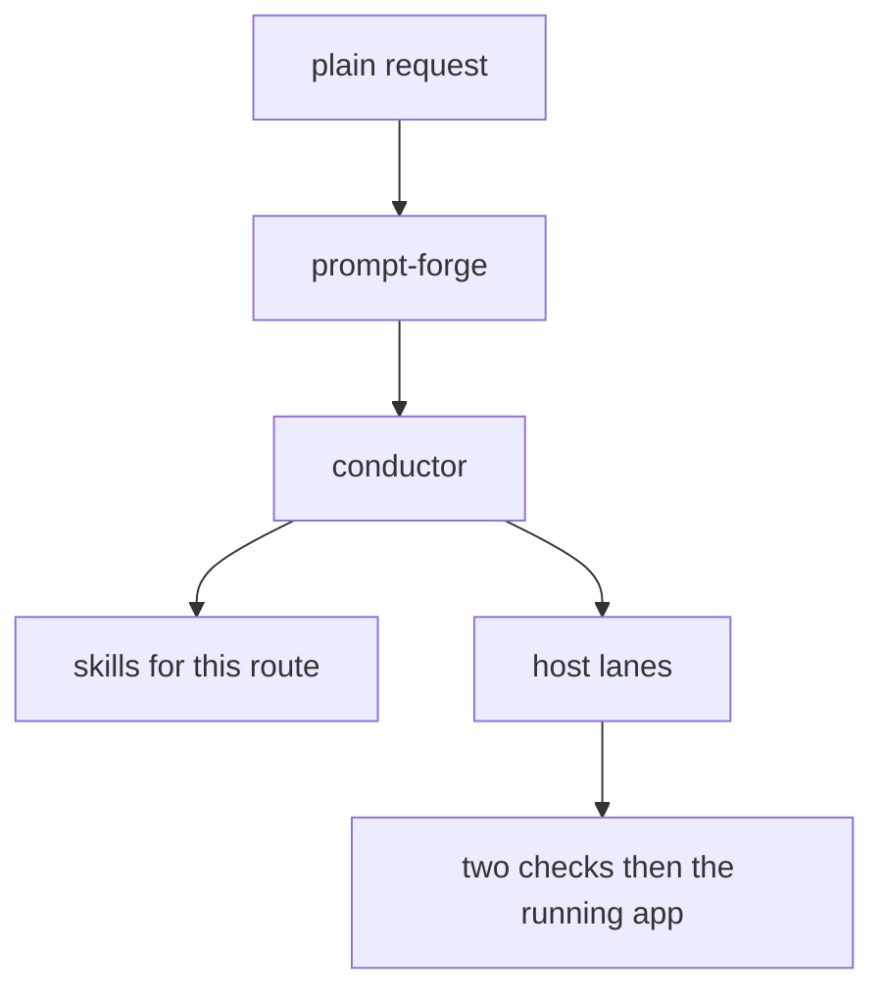

# Orchestra 3.3.5 architecture

One conductor. Skills are capabilities. The registry is the resource list. The private vault is memory and is not part of this public repo.

The design bar comes from project kind. Hiring work gets the full lab. Other showable work gets one approval. College work skips the lab unless asked.

A claim that this version beats a raw host waits for the 3H measurement.
