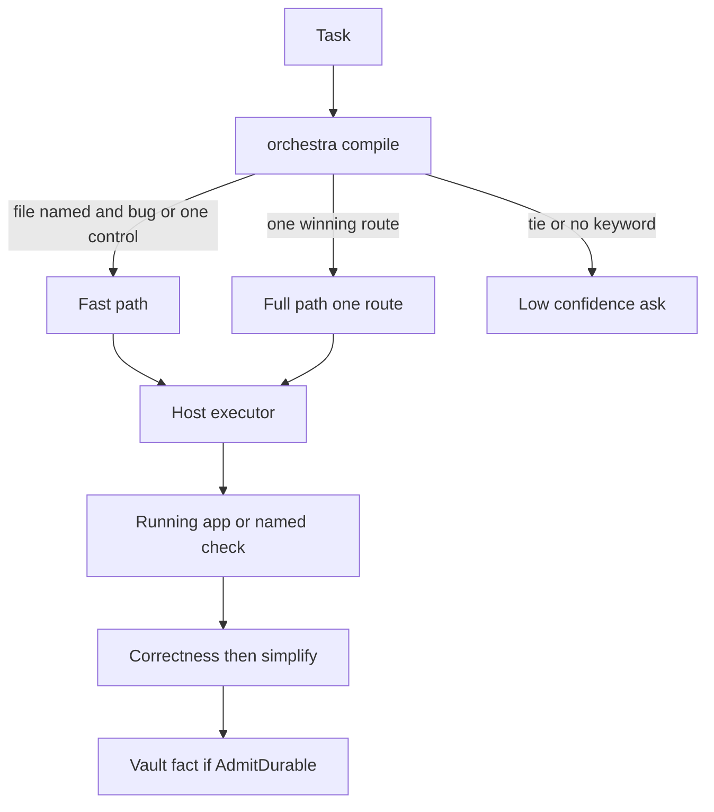

# Architecture 5.5

Recorded 2026-11-12. This is the target shape for a later code change. This file does not implement it. The current code is the eight-stage pipeline plus `orchestra compile`. Those stay until a change is authorized.

## Why not ten layers

The assignment listed ten layers: intent, classification, memory retrieval, planning, execution, verification, learning, evaluation, host compatibility, and security. The repo already splits the same ideas across `AGENTS.md`, `docs/CONDUCTOR.md` (still titled 4.6.0), `ARCHITECTURE.md` (eight design stages plus a mission capsule), and the README loop. Adding ten modules would make a fourth story.

Two speeds are enough. Security and host adapters are cross-cutting rules, not stages the model re-enters.

## Fast path

**Responsibility.** Change the named file. Run the named check.

**Input.** Task text that names a path, plus a bug, a typo, or one control.

**Output.** A diff and the command output.

**Dependencies.** The host’s editor and the project’s test command. No design lab. No `docs/CONDUCTOR.md`. No subagent.

**Failure.** The test fails, the path is missing, or the task also asks for a new product. Then it is not the fast path.

**Recovery.** Fix the test failure or stop and ask. Do not open the eight-stage pipeline because the argument was empty. Today `orchestra plan` invents a frontend task when `--task` is empty. That default goes away in the recommended change.

**Trust.** The model may edit the named files. It may not install global packages, force-push, or read `.env`. The hook is the backstop, and the default profile does not yet deny a false DONE.

**Verification.** The command the task named. Exit code in the same message as any DONE claim.

## Full path

**Responsibility.** One route from `registries/routing.json`. The skills that route lists. The skip line is binding.

**Input.** Task text. Optional quality bar: STANDARD, PREMIUM, EXPERIMENTAL. PREMIUM visual work still waits for a human yes on the contract and the stills. That gate is already in `ARCHITECTURE.md`. It stays.

**Output.** A manifest from `orchestra compile`: route, skills, model class as a hint, disclosure level, confidence, rejected routes. Then a diff, then evidence.

**Compile contract.**

| Result | Meaning |
| --- | --- |
| One winner, confidence = best / (best + second) | Use that route |
| Tie | `ambiguous`, confidence 0.5, ask or name both and let the user pick |
| No keyword | `unspecified`, confidence below 1, ask. Today the code leaves confidence at 1. That is the bug |

**Model class** on the route is a hint. The host picks the model. The manifest must not pretend otherwise.

**Failure classes** already named in `ARCHITECTURE.md`: environment, dependency, provider, implementation, test, specification, human-needed, timeout. A non-zero exit is not automatically an implementation bug. Specification and human-needed do not auto-retry. Identical retries stop. That policy stays.

**Recovery.** Retry only with a changed input, context, or approach, and only inside the retry budget. The budget code exists in the mission package. This document does not claim it is wired to every host session. A host that never runs the Go binary does not see it. The conductor skill has to say the same rule in a few lines, not by loading the 19 KB conductor doc.

**Verification.** The running app, or the named check. Source inspection is not verification. `NOT_APPLICABLE` is not a pass and is not `OutcomeSuccess`. `NOT_RUN` is not exit 0 when the check was required.

**Reviews.** Correctness, then simplify. The visual judge is not the builder. A typo does not get a panel.

## Memory write

After verification, a fact may be written only if `AdmitDurable` would accept the reason: user preference, architecture decision, validated workflow, failure lesson, verified resource, or project fact. Cap 8 durable facts in the selection function that already exists. Chat, tool logs, retries, and screenshots are not durable. The vault is the store. The SQLite type in `memory.go` is unused and should be deleted or marked dead when code changes are allowed. It is not a second brain.

Public repo files do not receive vault text. `publicSafe` and the hygiene pattern are the gate. They were not re-run here.

## Hosts

One route table, rendered into the adapters. Personal files that do not already look like Orchestra are left alone. Codex must be in the same parity map as the Node sync list. A missing host directory is `NOT_RUN`, not PASS.

## Security boundary

Fetched pages are data. The web adapter’s SSRF checks stay. Inspect should use the same checks before a code change. Hooks deny the destructive patterns. Skill text does not override the task. New skills do not install themselves.

## What this architecture refuses

A vector database. An in-process model router. A ten-step state machine with a new name for each existing function. A session-start plugin from another harness. Automatic promotion of a skill the same session wrote.

## File map for a later implementation

| Change | File |
| --- | --- |
| Confidence on a miss, fast-path flag | `runtime/internal/compile/compile.go` and `compile_test.go` |
| Empty plan does not invent a task | `runtime/cmd/orchestra/main.go` `runPlan` |
| PASS lines | `main.go` doctor, verify, and sync; `host_sync.go` `VerifyParity` |
| Skip is not a success memory | `runtime/internal/engine/stage_iterate.go` |
| Offline fetch is an error | `runtime/internal/adapters/acquisition/web.go` |
| Conductor text matches the pin and stays short | `docs/CONDUCTOR.md`, `skills/ow-conductor/SKILL.md` |
| Dead store | `runtime/internal/memory/memory.go` |

None of these edits are in this research pass.
