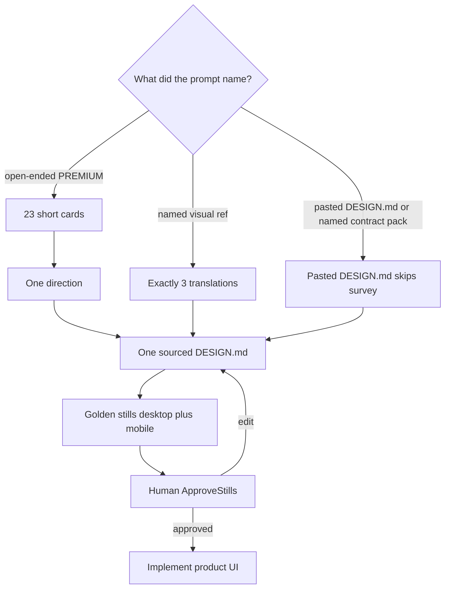

# Design Lab

Write lock on `PREMIUM` / `EXPERIMENTAL` visual work. Two locks: `CONTRACT_APPROVED` then `ApproveStills`. Golden stills are pre-implementation evidence. A `DESIGN.md` is not visual evidence.

Named visual references do **not** skip to one `DESIGN.md`. Tint: keep hierarchy, component grammar, spacing, interaction, shape. Replace color roles. Extend the new tokens. Do not clone trademarks or source.
