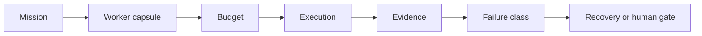
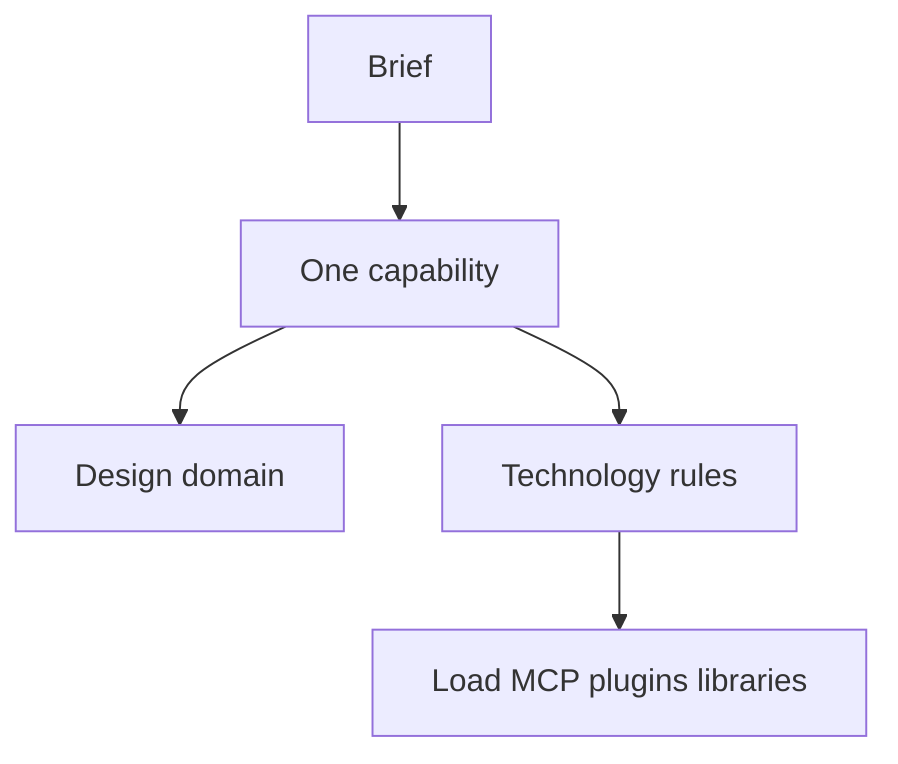
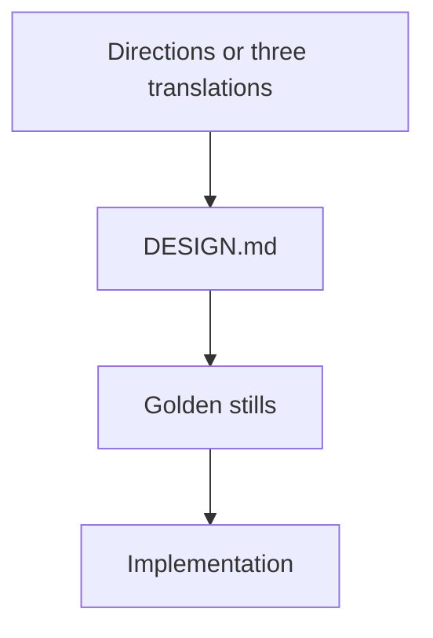
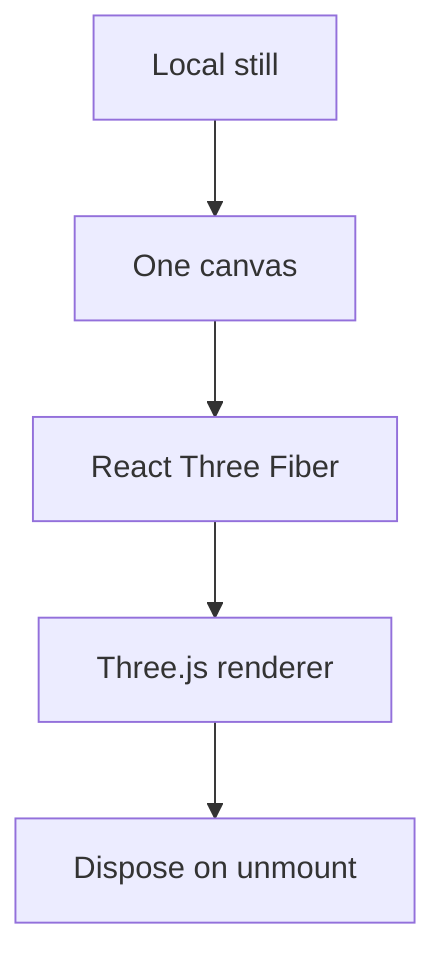
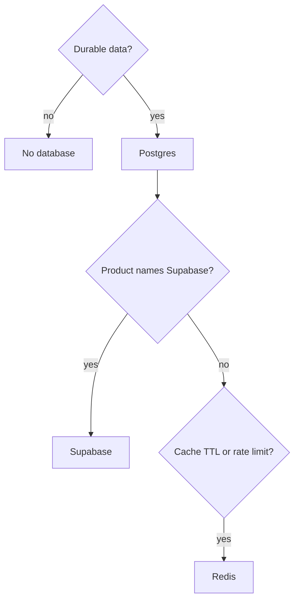
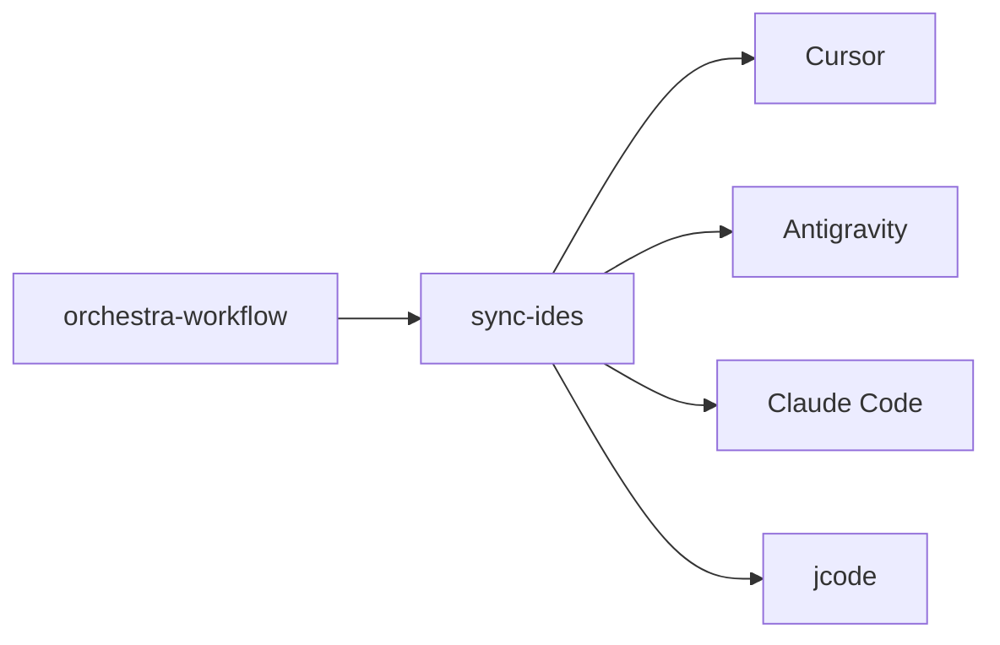

# System figures

GitHub renders these from the implementation. The three README figures are SVGs in `assets/`.

## Control plane

```mermaid
flowchart TD
  human[Human]
  conductor[One conductor]
  graph[Capability graph]
  note[Routing note]
  hosts[Host adapters]
  brain[Private Brain]
  human --> conductor
  conductor --> graph
  conductor --> note
  conductor --> hosts
  conductor --> brain
```

## Eight stages


## Mission



## What a task loads



## Design gate



## Scene



## Data store



## Hosts



Limitless Claude is a separate repository. It routes model providers. It is not a fifth copy of this contract.
